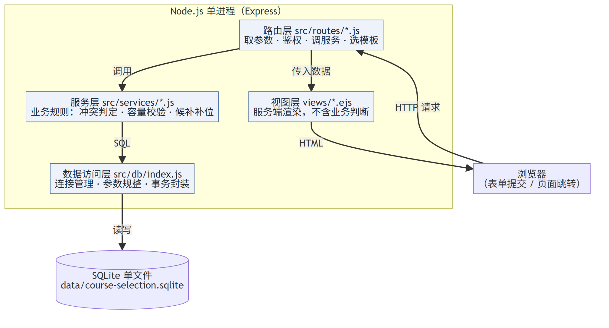
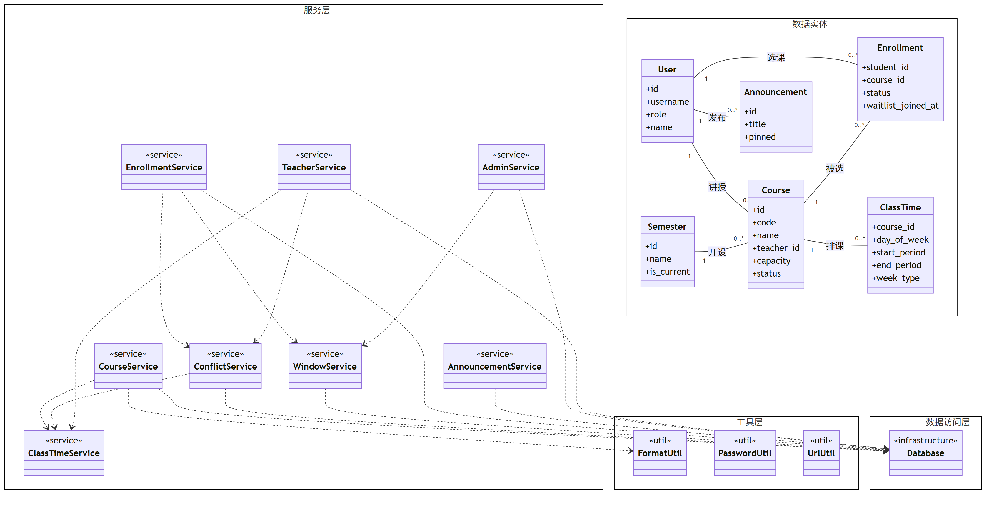

# 概要设计说明书

| 项目 | 内容 |
| --- | --- |
| 文档编号 | D2 |
| 项目名称 | 高校选课系统 |
| 版本 | v1.1（对应代码 v0.3.1） |
| 编写日期 | 2026-10-19 |
| 上游依据 | `docs/01-需求规格说明书.md`（D1）、`docs/04-数据库设计文档.md`（D4） |

---

## 一、引言

### 1.1 编写目的

回答三个问题：**系统分成哪几块、每块负责什么、块与块之间怎么协作**。
本文档是 D3 详细设计的输入——D3 只展开"某一个类内部怎么做"，不再重复分层与模块划分。

### 1.2 范围

覆盖总体架构、模块划分与职责边界、关键设计决策、部署结构。
不覆盖：具体算法实现细节（见 D3）、表结构与字段（见 D4）、逐个页面的交互细节（见 `docs/dev/03-接口与页面规范.md`）。

### 1.3 术语

| 术语 | 含义 |
| --- | --- |
| 层（Layer） | 按职责切分的横向分割，如路由层、服务层 |
| 模块（Module） | 按业务切分的纵向分割，如选课模块、公告模块 |
| 服务层 | 承载业务规则的一层，可被路由与脚本共同调用 |
| 不变式（Invariant） | 任何时刻都必须成立的条件，如"已选人数 ≤ 容量" |

### 1.4 参考

| 文档 | 用途 |
| --- | --- |
| `docs/01-需求规格说明书.md` | 12 条功能需求与其验收标准 |
| `docs/04-数据库设计文档.md` | 7 张表、约束与索引 |
| `docs/diagrams/class-diagram.mmd` | 类图源文件（本文第 4.2 节） |
| `docs/diagrams/architecture-layers.mmd` | 分层架构图源文件（本文第 3.1 节） |
| `docs/dev/01-架构与代码地图.md` | 代码级目录地图（面向维护，非交付物） |

---

## 二、设计目标与约束

### 2.1 设计目标

| 编号 | 目标 | 判断标准 |
| --- | --- | --- |
| G1 | **业务规则只有一处实现** | 选课规则只在服务层出现；路由与脚本调用同一函数 |
| G2 | **并发正确性优先于吞吐** | 并发选课零超卖（实测 10 抢 3） |
| G3 | **可交付、可演示** | 拿到压缩包双击即可运行，无需安装数据库 |
| G4 | **可维护** | 新增一个业务模块只需"加一个 service + 一个 route + 一个模块文档" |
| G5 | **不过度设计** | 不引入微服务、消息队列、前端框架与构建工具 |

### 2.2 设计约束

| 约束 | 来源 | 对架构的影响 |
| --- | --- | --- |
| Windows 缺原生编译工具链 | F1 | 只能用纯 JS / WASM 依赖；排除 `better-sqlite3`、`bcrypt` |
| 技术栈固定为 Node + Express + 数据库 + 原生前端 | F1 | 前端不引入构建步骤，页面由服务端渲染；数据库后由 SQLite 演进为 PostgreSQL（2026-10-22，仍不含原生编译） |
| 单机演示 | E1 | 单进程部署，不做水平扩展设计 |
| 不提供 Docker | F2 | 交付形态为"源码包 + 双击启动器" |
| 需要离线可用 | — | 除首次安装依赖外，运行期不依赖外网 |

---

## 三、系统总体架构

### 3.1 分层架构



> 源文件：`docs/diagrams/architecture-layers.mmd`

系统采用**四层结构**，请求自上而下穿透，响应自下而上返回：

```
浏览器 → 路由层 → 服务层 → 数据访问层（驱动分发） → SQLite / PostgreSQL
              ↘ 视图层 → 浏览器
```

### 3.2 各层职责与禁止事项

| 层 | 目录 | 职责 | **禁止** |
| --- | --- | --- | --- |
| 路由层 | `src/routes/` | 读取 `req`、鉴权、调用服务、选择模板、重定向 | 不写 SQL、不做业务判断、不拼装业务文案 |
| 服务层 | `src/services/` | 业务规则、组合多次数据操作、开启事务、返回统一结果对象 | 不接触 `req`/`res`、不渲染模板 |
| 数据访问层 | `src/db/` | 执行 SQL、参数规整、事务封装、连接管理 | 不含业务语义（不认识"选课"这个词） |
| 视图层 | `views/` | 展示数据、提交表单 | 不查数据库、不做业务判断 |
| 工具层 | `src/utils/` | 无状态纯函数（格式化、口令、路径校验） | 不依赖业务服务 |

**为什么要把这条边界写死**：业务规则一旦写进路由层，压测脚本就无法复用同一套判定，
测试与生产行为会分叉。这是本项目最容易被破坏的一条纪律——加功能时最省事的写法往往是
"直接在路由里查一下"，必须刻意避免。

### 3.3 一次请求的完整链路（以选课为例）

| 步 | 所在层 | 动作 |
| --- | --- | --- |
| 1 | — | 浏览器提交 `POST /enrollments`（表单含 `courseId`） |
| 2 | 中间件 | 解析表单 → 加载会话 → 注入 `req.user` 与 `res.locals` |
| 3 | 路由层 | `requireLogin`、`requireRole('student')` 校验 |
| 4 | 路由层 | 取 `courseId`，调用 `enrollmentService.enroll()` |
| 5 | 服务层 | `db.transaction()` 开启事务（`BEGIN IMMEDIATE`，全程持写锁） |
| 6 | 服务层 | 依次校验：窗口开放 → 课程未停开 → 未重复 → 无冲突 → 有余量 |
| 7 | 数据访问层 | 执行 `SELECT/INSERT/UPDATE`，返回受影响行 |
| 8 | 服务层 | 返回 `{ ok, code, message }` |
| 9 | 路由层 | 按结果写 flash，重定向回来源页 |
| 10 | 视图层 | 新页面渲染时读取 flash 显示提示 |

**关键点在第 5~6 步**：整段"校验 + 占用名额"必须在同一事务内，且校验顺序不可调换（R6）。

### 3.4 架构选型的候选方案对比

| 方案 | 优势 | 代价 | 结论 |
| --- | --- | --- | --- |
| **分层单体（采用）** | 结构简单、调试直观、单进程即可跑通 | 无法独立扩容某一模块 | ✅ 与 E1 演示规模匹配 |
| 前后端分离（React + REST API） | 前端体验好、可独立部署 | 需构建工具链、需设计 API 契约、演示时多一层失败点 | ❌ 超出需求范围 |
| 微服务（选课 / 课程 / 用户拆分） | 各服务可独立扩展 | 需服务发现、网关、分布式事务；作业场景反向拖慢交付 | ❌ 严重过度设计 |
| 传统 MVC 全家桶（如 NestJS） | 约束强、生态好 | 学习与配置成本高，本项目代码量用不上这些抽象 | ❌ 收益不足 |

**取舍理由**：本项目的复杂度不在"模块多"，而在"并发与规则正确"。分层单体把复杂度集中在
服务层的少数几个函数里，便于集中测试；而分布式架构会把复杂度转移到运维与一致性上，
与 E1（演示级规模）不匹配。

---

## 四、模块划分

### 4.1 模块清单

| 模块 | 服务类 | 路由 | 主要职责 |
| --- | --- | --- | --- |
| 课程查询 | `CourseService` | `routes/courses.js` | 检索、容量统计、课程详情 |
| 排课读取 | `ClassTimeService` | —（被其他模块调用） | 批量读取上课时间，供展示与冲突判定复用 |
| 冲突检查 | `ConflictService` | —（被选课与教师端调用） | 星期/节次/周次三条件判定 |
| 选课窗口 | `WindowService` | —（被首页与选课调用） | 窗口状态计算与时间解析 |
| 选课与候补 | `EnrollmentService` | `routes/enrollments.js` | 选课、退课、候补排序与补位 |
| 公告 | `AnnouncementService` | `routes/announcements.js` | 公告读取与写入 |
| 管理后台 | `AdminService` | `routes/admin.js` | 课程增删改、窗口配置、统计 |
| 教师端 | `TeacherService` | `routes/teacher.js` | 所授课程、选课名单、授课冲突 |
| 鉴权 | `PasswordUtil`、`middleware/auth.js` | `routes/auth.js` | 登录校验、角色鉴权、flash 注入 |

> 说明：`ClassTimeService`、`ConflictService`、`WindowService` 是**被复用的支撑模块**，
> 没有独立页面。它们的抽取原则是"被两个以上模块用到的逻辑"——
> 例如上课时间读取同时服务于课程展示与冲突判定，若留在其中一方会造成反向依赖。

### 4.2 类图（U2）



> 源文件：`docs/diagrams/class-diagram.mmd`
> 粒度说明：本图停留在**结构级**，只表达"有哪些类、怎么分层、谁依赖谁"。
> 服务类的方法签名会把图拉到 3000px 宽，塞进文档后无法阅读，故方法明细见 4.3 节的表。

### 4.3 类职责与方法

| 类 | 职责 | 主要方法 |
| --- | --- | --- |
| `CourseService` | 课程检索与容量汇总展示 | `listCourses`、`getCourseDetail`、`decorate` |
| `ClassTimeService` | 上课时间批量读取 | `loadByCourseIds`、`getByCourseId`、`loadStudentEnrolledTimes`、`loadTeacherTimes` |
| `ConflictService` | 时间冲突判定 | `timesConflict`、`periodsOverlap`、`weeksOverlap`、`findStudentConflicts`、`findTeacherConflicts` |
| `WindowService` | 选课窗口状态 | `getWindowState`、`getCurrentWindowState`、`parseTime` |
| `EnrollmentService` | 选课/退课/候补 | `enroll`、`drop`、`cancelWaitlist`、`listMyEnrollments`、`countEnrolled`、`promoteNext` |
| `AnnouncementService` | 公告读写 | `list`、`get`、`create`、`remove`、`togglePinned` |
| `AdminService` | 后台课程与窗口维护 | `listCourses`、`saveCourse`、`deleteCourse`、`saveWindow`、`enrollmentStats`、`overview` |
| `TeacherService` | 教师视角数据 | `overview`、`listMyCourses`、`getCourseStudents`、`findMyConflicts` |
| `FormatUtil` | 展示格式化 | `describeClassTime`、`credits`、`dateTime`、`enrollmentStatusLabel` |
| `PasswordUtil` | 口令派生与校验 | `hashPassword`、`verifyPassword` |
| `UrlUtil` | 跳转路径安全校验 | `safeInternalPath` |
| `Database` | 数据访问与事务 | `run`、`get`、`all`、`transaction`、`initSchema`、`close` |

### 4.4 模块依赖规则

1. **依赖方向单向**：路由 → 服务 → 数据访问。反向依赖一律禁止。
2. **服务之间可以横向调用**，但要避免环：本项目的依赖图为有向无环图，
   `EnrollmentService` 依赖 `ConflictService`，而后者不依赖前者。
3. **共享逻辑下沉到支撑模块**：`ClassTimeService` 与 `WindowService` 就是为打断"两个业务模块互相依赖"而抽取的。
4. **工具类不依赖服务**：`FormatUtil`、`PasswordUtil`、`UrlUtil` 只依赖标准库。

---

## 五、关键设计决策

### 5.1 服务层统一返回结果对象

**决策**：服务层不抛业务异常，一律返回 `{ ok, code, message, data }`。

| 候选 | 优势 | 劣势 |
| --- | --- | --- |
| **结果对象（采用）** | 路由与脚本用同一套判断；错误码可被测试断言 | 调用方必须显式判断 `ok`，忘记判断会静默失败 |
| 抛异常 | 强迫调用方处理 | 业务拒绝（如"已满"）与程序异常混在一起，日志难以区分 |
| 返回 `null` 表示失败 | 简单 | 丢失失败原因，无法给出精确提示 |

**收益**：`test/stress-test.js` 可以直接在服务层调用 `enroll()` 并统计结果分布，
不必启动 HTTP 服务；而路由层只需 `if (!result.ok) flash(result.message)`。

### 5.2 事务边界：一次业务操作一个事务

**决策**：`enroll`、`drop`、`saveCourse` 各自包在一个事务里，事务内**不做网络/文件 IO**。

**理由**：选课的不变式是"已选人数 ≤ 容量"。这条不变式跨越"读余量"和"写记录"两步，
若不放在同一事务，并发下必然出现超卖。实测（10 人抢 3 个名额）验证了这一点。

**代价**：事务粒度偏粗，热点课程上的请求会串行。演示规模可接受，且这正是 L1 记录的限制。

### 5.3 会话与鉴权

| 决策 | 内容 |
| --- | --- |
| 会话存储 | `express-session` 默认内存存储——重启即失效，属于演示级取舍 |
| 登录态注入 | 中间件 `attachUser` 统一把用户放进 `req.user` 与 `res.locals` |
| 鉴权方式 | 路由模块顶部统一 `router.use(requireLogin, requireRole(...))`，避免逐个路由漏加 |
| 未登录处理 | GET 跳登录页并带 `next`；表单 POST 也跳登录页；仅 `Accept: application/json` 返回 401 |
| 越权处理 | 返回 403（不是 404），便于区分"没权限"与"数据不存在" |

### 5.4 错误处理分级

| 状态码 | 处理 | 日志级别 |
| --- | --- | --- |
| 4xx | 渲染错误页，提示中文原因 | `[warn]` 单行（属于用户走错路，不是程序故障） |
| 5xx | 渲染错误页，提示"服务器内部错误" | `[error]` 带完整堆栈 |

**理由**：若把 404 也按 `[error]` 记录，日志里会充斥着爬虫与误点，真正的故障被淹没。

### 5.5 一个必须记住的坑：SQL 参数顺序

本项目使用 `node-sqlite3-wasm`，它对占位符顺序敏感。若把子查询混进 `SELECT` 子句，
参数顺序会变得难以维护，写错时**不报错、静默绑定到错误位置**。

**对策**：主查询只绑定 `WHERE` 条件；关联数据（上课时间、"我的选课状态"）拆成独立的批量查询，
在内存中合并。代价是多一次查询，收益是 SQL 不会悄悄出错。

### 5.6 演示数据中的"故意冲突"

种子里 `CS113` 与 `CS101` 同为周一 1-2 节（同一教师）。
这不是数据错误，而是为了让教师端"授课时间冲突提示"在演示时**有内容可看**。
真实教务系统中这正是需要被发现的排课事故。

---

## 六、数据设计概要

完整表结构见 D4。此处只说明与架构相关的三点：

| 关注点 | 设计 | 影响 |
| --- | --- | --- |
| 单一事实来源 | 所有建表语句只在 `src/db/schema.sql` | 应用代码不建表，避免结构漂移 |
| 约束下沉 | 唯一、CHECK、外键尽量交给数据库 | 应用层只处理跨表与业务语义约束 |
| 时间存储 | `TEXT 'YYYY-MM-DD HH:MM:SS'` | 可直接比较与排序；跨时区需另行约定（L4） |

---

## 七、接口设计概要

完整 URL 规划与权限矩阵见 `docs/dev/03-接口与页面规范.md`。此处只给出与架构相关的约定：

| 约定 | 内容 |
| --- | --- |
| 页面请求 | 服务端渲染，返回 HTML；写操作一律 POST + 重定向（PRG） |
| 健康检查 | `GET /health` 返回 `{ok, service, time}`，供启动器轮询就绪 |
| 对外 API | **不提供** REST API（需求未要求）；压测脚本走 HTTP 表单 + 进程内读库 |
| 提示信息 | 通过 session flash 传递，由 `partials/header.ejs` 统一渲染 |

---

## 八、部署结构

### 8.1 运行拓扑

```
┌──────────────────────────── 单台主机 ────────────────────────────┐
│                                                                  │
│   浏览器  ──HTTP──▶  Node.js 进程（Express，监听 PORT）           │
│                              │                                   │
│                              ▼                                   │
│    PostgreSQL（Neon，生产/默认）  ／  SQLite 单文件（离线开发/回退）   │
│                                                                  │
└──────────────────────────────────────────────────────────────────┘
```

- **单进程**：同一时刻只允许一个进程打开数据库文件；
- **无外部依赖**：不需要数据库服务、缓存、消息队列；
- **可移植**：整目录拷贝即可迁移，数据在 `data/` 下。

### 8.2 启动流程

| 方式 | 流程 |
| --- | --- |
| **一键启动（推荐）** | 双击 `start.bat` → 检查依赖（缺则 `npm install`）→ 检查数据库（缺则初始化）→ 启动服务 → 轮询 `/health` → 打开浏览器 |
| 手动启动 | `npm install` → `npm run init-db` → `npm start` |

启动器的设计取舍：

| 场景 | 行为 | 理由 |
| --- | --- | --- |
| 端口 3000 被占用 | 自动顺延（最多 10 个） | 避免"启动失败但不知道原因" |
| 本服务已在运行 | 只打开浏览器，不重复启动 | 两个进程会争抢同一 SQLite 文件，宁可拒绝 |
| 缺依赖 / 缺数据 | 自动补齐 | 降低交付门槛，"拿到就能跑" |

### 8.3 配置项

| 环境变量 | 默认值 | 说明 |
| --- | --- | --- |
| `PORT` | `3000` | 监听端口 |
| `HOST` | `0.0.0.0` | 监听地址 |
| `DATABASE_URL` | 空 | **有值则走 PostgreSQL**；为空回退 SQLite |
| `DB_DRIVER` | 自动判断 | `pg` / `sqlite`，显式覆盖（用于回归测试） |
| `DB_FILE` | `data/course-selection.sqlite` | SQLite 文件路径（测试时指向临时文件） |
| `PG_POOL_MAX` | `10` | PostgreSQL 连接池上限 |
| `SESSION_SECRET` | 开发用固定值 | 会话签名密钥，正式部署须修改 |

### 8.4 交付与安装

| 交付物 | 形态 | 说明 |
| --- | --- | --- |
| 源码包 | `release/course-selection-system-v0.3.1.zip`（本地已生成；GitHub Release 待发布） | 解压后双击 `start.bat` 即可运行（离线模式） |
| 源码归档 | Release 页的 `Source code (zip)` | 内容等价，含启动器 |
| 文档 | `docs/` 下 Markdown + `docs/diagrams/` 下 PNG/SVG | 见第十一节 |

---

## 九、非功能设计的落地

| 需求（来自 D1） | 设计上的对应措施 |
| --- | --- |
| NFR-P2 并发正确性 | 单事务 + 实时计数 + `UNIQUE(student_id, course_id)` 三重保障 |
| NFR-S2 越权防护 | 路由级 `requireRole` + 查询条件内嵌 `teacher_id`（不做事后判断） |
| NFR-S3 防开放重定向 | `UrlUtil.safeInternalPath` 统一校验 |
| NFR-A2 异常后自愈 | 启动时清理残留锁目录并提示 |
| NFR-M1 分层清晰 | 各层"禁止事项"明确写入 3.2 节，并由代码评审把关 |
| NFR-M3 规则可复用 | 5.1 节的统一结果对象 |
| NFR-C3 免原生编译 | 依赖选型阶段即排除 `node-gyp` 包 |

---

## 十、已知限制与演进

| 编号 | 限制 | 影响 | 演进方向 |
| --- | --- | --- | --- |
| A1 | ~~单进程 + SQLite 单写者~~ → **已迁移 PostgreSQL** | — | 2026-10-22 完成；现支持多实例共用一个库，并发由 `SELECT ... FOR UPDATE` 保证（见 dev/07、dev/08） |
| A2 | 会话存内存 | 重启后需重新登录 | 接 Redis 或改用签名 Cookie |
| A3 | 无缓存层 | 每次请求都查库 | 演示规模无需；课程列表可加 60s 内存缓存 |
| A4 | 无异步任务 | 补位与通知同步执行 | 引入队列（超出本期范围） |
| A5 | 无 CI | 测试靠手动 | 接 GitHub Actions 跑三个测试脚本 |

**架构演进的原则**：换数据库只改 `src/db/`，换前端只改 `views/` 与 `routes/` 的渲染部分，
业务规则不受影响——这正是分层带来的收益。

---

## 十一、与上下游文档的对应关系

| 文档 | 关系 |
| --- | --- |
| D1 需求规格说明书 | 上游。本文的每个模块都能追溯到 D1 的 FR 条目 |
| D3 详细设计说明书 | 下游。展开本文 4.3 节中各类的内部实现与关键算法 |
| D4 数据库设计文档 | 并行。本文只讲"怎么用数据"，D4 讲"数据长什么样" |
| D5 测试用例与测试报告 | 下游。按 D1 的验收标准设计用例，验证本文的设计是否达成 |
| D6 项目总结报告 | 下游。复盘本文决策的实际效果 |

### 11.1 模块到需求的映射

| 模块 | 对应需求 |
| --- | --- |
| 课程查询 | FR-01 |
| 选课与候补 | FR-02、FR-04、FR-07 |
| 退课 | FR-03 |
| 冲突检查 | FR-05 |
| 我的选课 | FR-06 |
| 公告 | FR-08 |
| 选课窗口 | FR-09 |
| 管理后台 | FR-04、FR-08、FR-09 |
| 教师端 | FR-11 |
| 鉴权 | FR-00 |
| 压测脚本 | FR-10 |

---

*文档结束*
