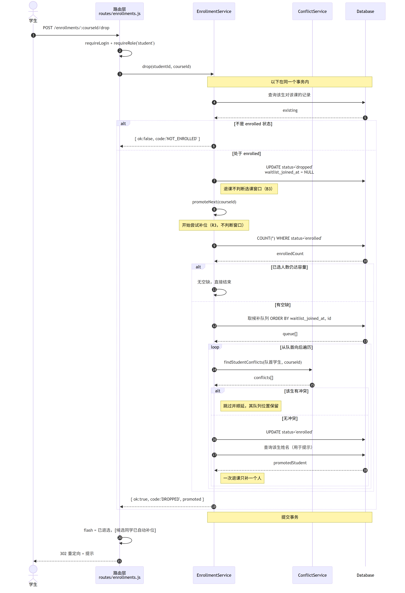
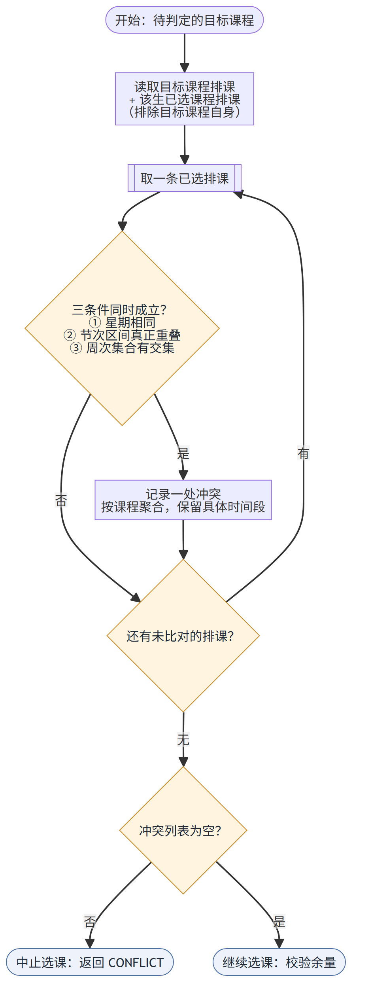
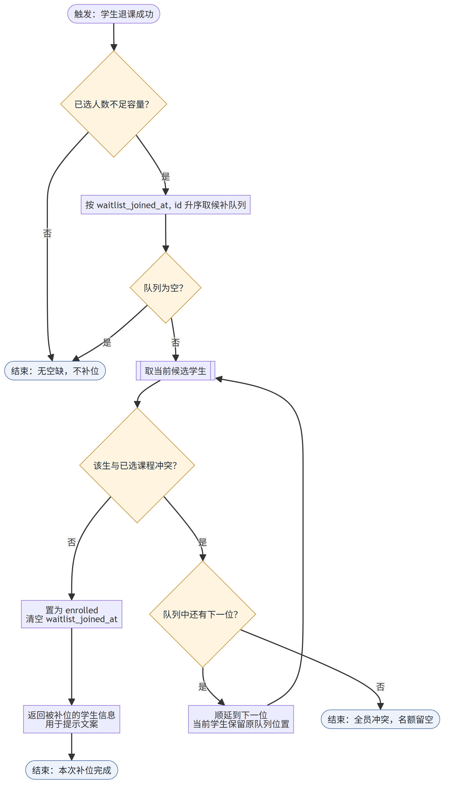
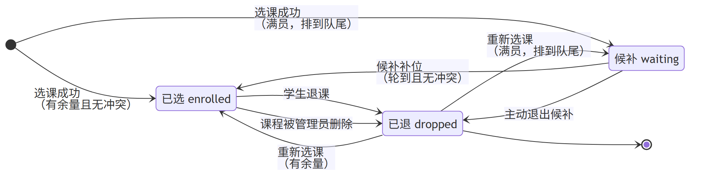
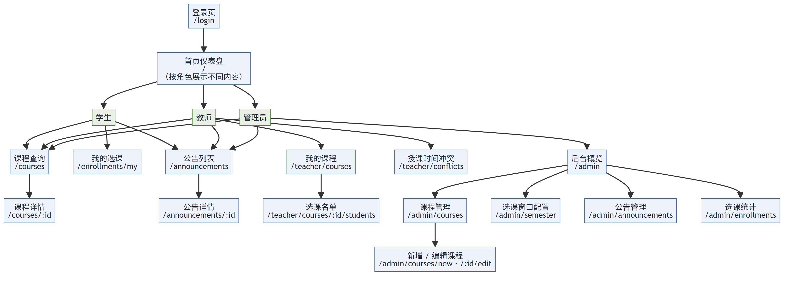

# 详细设计说明书

| 项目 | 内容 |
| --- | --- |
| 文档编号 | D3 |
| 项目名称 | 高校选课系统 |
| 版本 | v1.0（对应代码 v0.2.1） |
| 编写日期 | 2026-10-19 |
| 上游依据 | `docs/01-需求规格说明书.md`（D1）、`docs/02-概要设计说明书.md`（D2） |

---

## 一、引言

### 1.1 编写目的

把 D2 的模块划分落到**类与方法级别**：每个类有哪些方法、关键算法怎么实现、
异常怎么处理、界面由哪些要素构成。读完本文应能直接对照代码复核实现是否符合设计。

### 1.2 范围

| 覆盖 | 不覆盖 |
| --- | --- |
| 9 个服务类、3 个工具类、1 个数据访问类的接口与实现要点 | 逐行代码解释（看源码即可） |
| 4 个关键算法的伪代码与边界 | 数据库表结构（见 D4） |
| 6 张动态行为图（时序 / 活动 / 状态） | 部署与运维步骤（见 `docs/dev/04-运行与维护手册.md`） |
| 界面构成、交互约定与页面要素 | 视觉稿（本项目无 UI 设计稿，样式见 `public/css/style.css`） |

### 1.3 术语

| 术语 | 含义 |
| --- | --- |
| 服务层契约 | 服务层方法统一的返回结构 `{ ok, code, message, data }` |
| 事务边界 | 一次业务操作中"要么全成功、要么全回滚"的范围 |
| 跳位补位 | 候补补位时遇冲突则跳过该生、顺延下一位，该生保留队列位置 |
| PRG | Post-Redirect-Get，写操作后重定向，避免刷新重复提交 |

### 1.4 参考

| 文档 / 文件 | 用途 |
| --- | --- |
| `docs/02-概要设计说明书.md` | 分层、模块与依赖规则 |
| `docs/04-数据库设计文档.md` | 表结构与约束 |
| `docs/dev/03-接口与页面规范.md` | URL 与权限矩阵 |
| `test/conflict-test.js` | 冲突判定的 26 条单元用例 |
| `test/stress-test.js` | 并发与补位的 15 条用例 |

---

## 二、类设计

### 2.1 服务层统一契约

**所有服务方法的返回值**：

```js
{ ok: true,  code: 'ENROLLED',  message: '选课成功：数据结构', data: { status: 'enrolled' } }
{ ok: false, code: 'CONFLICT',  message: '与已选课程时间冲突：高等数学 A（MA101）',
  data: { conflicts: [...] } }
```

**约定**：

| 项 | 规定 |
| --- | --- |
| `ok` | `true` 表示业务成功；`false` 表示**业务拒绝**（不是程序异常） |
| `code` | 大写下划线常量，供测试与前端分支判断，不用于展示 |
| `message` | 面向用户的中文提示，由路由层直接放入 flash |
| `data` | 可选，供调用方进一步处理（如冲突列表、候补位次） |
| 异常 | 只有**真正的程序错误**（如 SQL 语法错）才抛异常，交给统一错误处理中间件 |

**为什么不用异常表示业务失败**：业务拒绝（"名额已满"）是正常流程的一部分，
用异常表达会让"预期内的拒绝"和"意外故障"混在同一套 catch 里，日志与监控难以区分。

### 2.2 `EnrollmentService` — 选课与候补（核心类）

#### 方法

| 方法 | 入参 | 返回 | 说明 |
| --- | --- | --- | --- |
| `enroll` | `studentId, courseId` | `{ok, code, message, data}` | 选课主流程，五步校验 + 占用名额 |
| `drop` | `studentId, courseId` | 同上 | 退课 + 触发补位 |
| `cancelWaitlist` | `studentId, courseId` | 同上 | 主动退出候补 |
| `listMyEnrollments` | `studentId` | `{enrolled[], waiting[], totalCredits}` | 我的选课（候补附位次） |
| `countEnrolled` | `courseId` | `number` | 已选人数（唯一口径） |
| `countWaiting` | `courseId` | `number` | 候补人数 |
| `promoteNext` | `courseId, course, now` | `{studentId, name} \| null` | 补位（内部方法，导出供测试） |

#### 实现要点

1. **入口先做参数归一**：`toCourseId()` 把字符串转正整数，非法即返回 `COURSE_NOT_FOUND`，
   不进入事务，避免无谓加锁。
2. **整体包在 `db.transaction()` 中**：事务开头 `BEGIN IMMEDIATE` 直接取写锁，
   而不是"先读后升级"，可避免锁升级死锁。
3. **校验顺序固定**（R6）：窗口 → 课程状态 → 重复 → 冲突 → 余量。
   顺序调换不会报错，但会改变并发下的行为（例如先查余量再查冲突，会白白占用名额判定）。
4. **记录复用**：若该生此前退过这门课，`upsertEnrollment` 更新原行而不是插入新行——
   受 `UNIQUE(student_id, course_id)` 约束，插入会失败。

### 2.3 `ConflictService` — 时间冲突判定

| 方法 | 说明 |
| --- | --- |
| `timesConflict(a, b)` | 两段排课是否冲突（三条件与） |
| `periodsOverlap(a, b)` | 节次区间是否真正重叠（闭区间） |
| `weeksOverlap(a, b)` | 周次集合是否有交集（含单双周） |
| `matchWeekType(week, type)` | 某周是否属于单/双/每周 |
| `findStudentConflicts(studentId, courseId)` | 该生选此课会与哪些已选课程冲突 |
| `findTeacherConflicts(teacherId)` | 该教师所授课程之间的冲突对 |

**设计特点**：除两个 `find*` 外全是**纯函数**（不碰数据库），因此可以用 26 条单元测试
直接覆盖边界，不需要造页面数据。这是本项目测试性价比最高的一处。

### 2.4 `WindowService` — 选课窗口

| 方法 | 说明 |
| --- | --- |
| `getWindowState(semester)` | 返回 `{open, code, label, openAt, closeAt}` |
| `getCurrentWindowState()` | 取当前学期后调用上者 |
| `parseTime(value)` | `'YYYY-MM-DD HH:MM:SS'` → 时间戳 |

**状态机**：`NO_SEMESTER`（未配置学期）→ `NOT_CONFIGURED`（未配窗口）→
`NOT_STARTED`（未到开放时间）→ `OPEN` / `CLOSED`。

**`parseTime` 的必要性**：`new Date('2026-10-16 10:00:00')` 在部分 JS 环境解析不可靠，
必须先 `replace(' ', 'T')`。这一行是全项目最容易踩的坑之一。

### 2.5 `CourseService` — 课程查询

| 方法 | 说明 |
| --- | --- |
| `listCourses(options)` | 检索 + 容量统计 + 筛选下拉数据 |
| `getCourseDetail(courseId, studentId)` | 单门课程详情 |
| `decorate(rows, classTimeMap, myStatusMap)` | 为课程行补充派生字段 |

`decorate` 补充的派生字段：`remaining`（余量）、`isFull`、`selectable`、`reason`（不可选原因）、
`class_times`、`my_status`。

### 2.6 `AdminService` — 管理后台

| 方法 | 说明 |
| --- | --- |
| `listCourses(semesterId)` | 管理视角列表（含停开课程与排课段数） |
| `getCourseForEdit(courseId)` | 课程 + 排课（供表单回填） |
| `validateCourse(input)` | 字段校验，返回 `{ok, message}` |
| `saveCourse(input)` | 新增或更新（排课整体替换，事务内） |
| `deleteCourse(courseId)` | 删除；有生效选课记录时拒绝 |
| `saveWindow({semesterId, openAt, closeAt})` | 保存选课窗口 |
| `enrollmentStats(semesterId)` | 各课程已选/候补/满员率 |
| `overview(semesterId)` | 后台概览数字 |

### 2.7 `TeacherService` — 教师端

| 方法 | 说明 |
| --- | --- |
| `overview(teacherId)` | 所授课程数、选课人次、冲突处数 |
| `listMyCourses(teacherId)` | 名下课程 + 排课 |
| `getCourseStudents(teacherId, courseId)` | **课程不属于本人时返回 `null`** |
| `findMyConflicts(teacherId)` | 转调 `conflictService.findTeacherConflicts` |

**权限实现要点**：`getCourseStudents` 把 `teacher_id` 直接写进 `WHERE`，
而不是"先按 id 查出来再比对"——漏写条件的方向是"查不到"（安全），
漏写比对的后果是"越权能看"（危险）。

### 2.8 `AnnouncementService` — 公告

| 方法 | 说明 |
| --- | --- |
| `list({limit})` | 置顶优先，其余按发布时间倒序；`limit` 夹在 200 以内 |
| `get(id)` | 单条，非正整数返回 `null` |
| `create({title, content, pinned, authorId})` | 发布，含长度校验 |
| `remove(id)` | 删除 |
| `togglePinned(id)` | 切换置顶 |

排序带 `id DESC` 作为兜底：同一秒发布的两条公告 `created_at` 相同，只按时间排序结果不稳定。

### 2.9 工具类

| 类 | 方法 | 说明 |
| --- | --- | --- |
| `FormatUtil` | `describeClassTime`、`shortClassTime`、`periodLabel`、`timeRange`、`weekTypeLabel`、`weekRangeLabel`、`credits`、`dateTime`、`date`、`truncate`、`enrollmentStatusLabel`、`courseStatusLabel` | 全部为纯格式化，无副作用 |
| `PasswordUtil` | `hashPassword(password)`、`verifyPassword(password, hash, salt)` | `crypto.scryptSync` + 随机盐，输出十六进制 |
| `UrlUtil` | `safeInternalPath(value, fallback)` | 只允许站内路径；拒绝绝对地址、`//` 开头、含 `\` |

### 2.10 数据访问层 `Database`

| 方法 | 说明 |
| --- | --- |
| `initSchema()` | 执行 `schema.sql` 建表 |
| `run(sql, ...params)` | 写操作，返回 `{changes, lastInsertRowid}` |
| `get(sql, ...params)` | 取单行，无结果返回 `undefined` |
| `all(sql, ...params)` | 取多行，返回数组 |
| `transaction(fn)` | 事务包装：`BEGIN IMMEDIATE` → `fn()` → `COMMIT`，异常时 `ROLLBACK` |
| `close()` | 关闭连接 |

**参数规整**：`node-sqlite3-wasm`（SQLite 驱动）只接受数组或对象形式的参数，可变参数只绑定第一个。
数据层统一 `normalizeParams()` 处理，否则会出现"数字参数变成 NULL 且不报错"的静默错误。

---

## 三、关键算法设计

### 3.1 选课校验链

**目标**：在并发下保证不变式「已选人数 ≤ 容量」，且给出精确的拒绝原因。

```
function enroll(studentId, courseId):
    id = toCourseId(courseId)
    if id is null: return fail(COURSE_NOT_FOUND)

    return db.transaction(() =>            # ① 全程持写锁
        course = getCourseRow(id)
        if not course:                 return fail(COURSE_NOT_FOUND)

        # ② 窗口校验（B2）
        if not windowService.isOpen(course.semester_id):
            return fail(WINDOW_CLOSED, windowService.label)

        # ③ 课程状态
        if course.status != 'open':    return fail(COURSE_CLOSED)

        # ④ 重复选课
        existing = findEnrollment(studentId, id)
        if existing.status == 'enrolled': return fail(ALREADY_ENROLLED)
        if existing.status == 'waiting':  return fail(ALREADY_WAITING)

        # ⑤ 时间冲突（C1~C3）
        conflicts = conflictService.findStudentConflicts(studentId, id)
        if conflicts not empty:
            return fail(CONFLICT, 拼接冲突课程名, {conflicts})

        # ⑥ 余量判定（实时计数）
        if countEnrolled(id) < course.capacity:
            upsert(existing, status='enrolled', waitlist_joined_at=NULL)
            return ok(ENROLLED)

        # ⑦ 候补（R2：队列上限 = 容量）
        if countWaiting(id) >= course.capacity:
            return fail(WAITLIST_FULL)
        upsert(existing, status='waiting', waitlist_joined_at=now)
        return ok(WAITLISTED, position=waitlistPosition(id, studentId))
    )
```

**边界**：

| 情况 | 处理 |
| --- | --- |
| `courseId` 为非正整数 / `abc` | 入口直接拒绝，不进事务 |
| 容量为 0 | 永远走候补分支；候补上限也是 0，故直接 `WAITLIST_FULL` |
| 学生曾退过这门课（`dropped`） | 复用原行，`waitlist_joined_at` 刷新 → 排到队尾（R9） |
| 课程不属于当前学期 | 窗口状态取自该课所属学期，仍可正确判定 |

### 3.2 时间冲突判定

**判定式（R4）**：两门课冲突 ⟺ 星期相同 **且** 节次真正重叠 **且** 周次有交集。

```
function timesConflict(a, b):
    return a.day == b.day
       and a.start <= b.end and b.start <= a.end     # 闭区间；相邻不算（C3）
       and weeksOverlap(a, b)                        # 含单双周（C2）

function weeksOverlap(a, b):
    lo = max(a.startWeek, b.startWeek)
    hi = min(a.endWeek,   b.endWeek)
    if lo > hi: return false
    for w in lo..hi:                                 # 最长 16 周
        if matchWeekType(w, a.type) and matchWeekType(w, b.type):
            return true
    return false

function matchWeekType(w, type):
    if type == 'odd':  return w % 2 == 1
    if type == 'even': return w % 2 == 0
    return true                                      # 'all'
```

**关键边界**（26 条单元测试全部覆盖）：

| 情形 | 结果 | 依据 |
| --- | --- | --- |
| 第 1-2 节 vs 第 3-4 节 | **不冲突** | 相邻时段不算（C3） |
| 第 1-2 节 vs 第 2-3 节 | 冲突 | 第 2 节重叠 |
| 第 1-4 节 vs 第 2-3 节 | 冲突 | 包含关系 |
| 单周课 vs 双周课（同天同时段） | **不冲突** | 周次集合不相交（C2） |
| 单周课 vs 每周课 | 冲突 | 每周包含单周 |
| 每周 1-8 周 vs 每周 9-16 周 | 不冲突 | 区间不相交 |
| 每周 1-8 周 vs 每周 8-16 周 | 冲突 | 第 8 周重叠 |

**性能**：一次判定最多 16 次整数比较，可忽略。

### 3.3 候补补位（本项目最绕的一段）

```
function promoteNext(courseId, course, now):
    if countEnrolled(courseId) >= course.capacity: return null   # 无空缺

    queue = SELECT id, student_id FROM enrollment
            WHERE course_id=? AND status='waiting'
            ORDER BY waitlist_joined_at, id                      # R1 FIFO

    for item in queue:
        conflicts = findStudentConflicts(item.student_id, courseId)
        if conflicts not empty:
            continue          # 跳过并顺延；该生保留队列位置
        UPDATE enrollment SET status='enrolled',
                              waitlist_joined_at=NULL
         WHERE id = item.id
        return { studentId, name }                                # 一次只补一人
    return null               # 全员冲突 → 名额留空
```

**三个容易做错的地方**：

| 陷阱 | 正确做法 | 若做错会怎样 |
| --- | --- | --- |
| 补位时判断选课窗口 | **不判断** | 窗口关闭后退课就补不上人，名额永久空置（违反 R3） |
| 冲突者是"跳过"还是"移出队列" | **跳过，保留位置** | 移出队列对临时冲突的学生过严；不跳过则卡住整条队列 |
| 一次补几个 | **只补一个** | 一次退课只释放一个名额，补多个会超容量 |

### 3.4 余量统计与 N+1 规避

课程列表需要每门课的已选人数、候补人数、排课时间、"我的选课状态"。

**错误做法**：查出课程列表后，对每门课分别查一次人数与排课（N+1 问题）。

**本项目做法**：

| 数据 | 获取方式 |
| --- | --- |
| 已选/候补人数 | 主查询中用**相关子查询**一次算出 |
| 排课时间 | 单独一次 `WHERE course_id IN (...)` 批量查，按 course_id 分组成 `Map` |
| 我的选课状态 | 同理批量查后合并为 `Map` |

**为什么不把后两者塞进主查询**：`node-sqlite3-wasm`（SQLite 驱动）对占位符顺序敏感，
子查询混进 `SELECT` 会让参数顺序难以维护，写错时**静默绑错位置**。
多两次简单查询换来"不会悄悄出错"，这笔交易值得。

### 3.5 口令派生

```
function hashPassword(password):
    salt = randomBytes(16).toString('hex')
    hash = scryptSync(password, salt, 64).toString('hex')
    return { hash, salt }

function verifyPassword(password, hash, salt):
    return timingSafeEqual(scryptSync(password, salt, 64), Buffer.from(hash,'hex'))
```

- 使用 Node 内置 `crypto.scryptSync`，避免 `bcrypt` 的原生编译依赖（F1 约束）。
- 校验用 `timingSafeEqual` 防时序攻击。
- **已知缺口**：演示账号口令为 `123456`，仅用于教学演示（D1 GAP-S3）。

---

## 四、动态行为设计

### 4.1 选课时序（U3）


> 源文件：`docs/diagrams/sequence-select-course.mmd`

要点：

1. 五步校验在**同一事务**内，图上用黄色注释标出事务边界；
2. 每个拒绝点都直接返回带 `code` 的结果对象，不在中途写库；
3. 余量判定用事务内实时 `COUNT(*)`，不使用页面传入的数字。

### 4.2 退课与补位时序（U4）



> 源文件：`docs/diagrams/sequence-drop-course.mmd`

要点：

1. 退课**不判断选课窗口**（B3）；
2. 退课成功后立即尝试补位，补位同样不判断窗口（R3）；
3. 补位内部有 `loop` + `alt`：逐个候选判定冲突，遇冲突跳过。

### 4.3 时间冲突校验活动（U5）



> 源文件：`docs/diagrams/activity-conflict-check.mmd`

三条件合并在一个判定节点中表达。**两处空集合边界**未画入图中，在此说明：

| 边界 | 处理 |
| --- | --- |
| 目标课程没有任何排课 | 直接判为不冲突（无法与任何时段冲突） |
| 学生没有任何已选课程 | 直接判为不冲突 |

### 4.4 候补补位活动（补充图）



> 源文件：`docs/diagrams/activity-promote-waitlist.mmd`

单独画这一张，是因为"跳过并顺延、同时保留队列位置"用文字描述极易被理解成"移出队列"。
图中把两条分支（置为已选 / 顺延下一位）并列展示，避免歧义。

### 4.5 选课记录状态（U6）



> 源文件：`docs/diagrams/state-course-selection.mmd`

| 迁移 | 触发者 | 说明 |
| --- | --- | --- |
| `[*]` → 已选 | 学生 | 有余量且无冲突 |
| `[*]` → 候补 | 学生 | 满员但候补未满 |
| 已选 → 已退 | 学生 / 管理员 | 退课；或课程被删除 |
| 候补 → 已选 | **系统** | 补位轮到且无冲突 |
| 候补 → 已退 | 学生 | 主动退出候补 |
| 已退 → 已选 / 候补 | 学生 | 重新选课（R9，排到队尾） |

**注意**：一个学生对一门课始终只有一条记录，状态在三个值之间迁移，从不新增行。

---

## 五、界面设计

### 5.1 页面结构与导航



> 源文件：`docs/diagrams/ui-sitemap.mmd`

三类角色登录后进入同一个首页，但首页内容按角色不同；导航栏按角色显示可访问入口。
完整 URL 与权限矩阵见 `docs/dev/03-接口与页面规范.md`。

### 5.2 页面要素

#### 公共页面

| 页面 | 主要要素 | 交互 |
| --- | --- | --- |
| 登录 `/login` | 学号/工号、密码、错误提示、`next` 隐藏字段 | 提交失败保留已填账号 |
| 首页 `/` | 选课窗口状态徽标、按角色的统计卡片、最新 5 条公告 | 卡片可点击跳转 |
| 课程查询 `/courses` | 检索栏（关键词/院系/教师/星期）、课程表格、空态提示 | 检索走 GET，可分享链接 |
| 课程详情 `/courses/:id` | 排课、地点、简介、容量进度条、候补人数 | 学生可见选课/退课按钮 |
| 公告列表 / 详情 | 置顶标记、作者、时间、正文 | 正文保留换行 |

#### 学生页面

| 页面 | 主要要素 | 交互 |
| --- | --- | --- |
| 我的选课 `/enrollments/my` | 已选课程表（含合计门数与学分）、候补表（含位次） | 退课需二次确认；退出候补一键 |

#### 教师页面

| 页面 | 主要要素 | 交互 |
| --- | --- | --- |
| 教师端首页 `/teacher` | 所授课程数、选课人次、冲突提示条 | 冲突存在时红色提示 |
| 我的课程 `/teacher/courses` | 课程表（含排课、已选/容量、候补） | 进入名单 |
| 选课名单 `/teacher/courses/:id/students` | 已选名单（学号/姓名/年级/院系/选课时间）、候补队列（含位次） | 只读 |
| 授课冲突 `/teacher/conflicts` | 冲突课程对 + 具体撞车时段（左右对照表） | 无冲突时显示判定口径说明 |

#### 管理页面

| 页面 | 主要要素 | 交互 |
| --- | --- | --- |
| 后台概览 `/admin` | 7 个统计卡片、4 个功能入口 | 入口卡片可点击 |
| 课程管理 `/admin/courses` | 课程表（含排课段数、满员标记）、新增按钮 | 删除需确认；有选课记录时拒绝 |
| 课程表单 `/admin/courses/new`·`/:id/edit` | 基本信息 + **动态排课行**（可增删） | 校验失败回填已填内容 |
| 选课窗口 `/admin/semester` | 开放/截止时间（`datetime-local`）、当前状态徽标 | 保存后立即生效 |
| 公告管理 `/admin/announcements` | 发布表单、公告表（置顶/删除） | 发布后回到本页 |
| 选课统计 `/admin/enrollments` | 按已选人数降序、满员率进度条 | 只读 |

### 5.3 交互约定

| 约定 | 内容 |
| --- | --- |
| 写操作 | 一律 POST + 重定向（PRG），成功后 302 回来源页 |
| 提示 | 通过 session flash 传递，由 `partials/header.ejs` 统一渲染为绿/红条 |
| 表单校验失败 | 返回 400 并**重新渲染原页**，保留用户已填内容，页顶显示错误条 |
| 空态 | 每个列表都有空态文案（如"没有符合条件的课程"），不留空白 |
| 危险操作 | 退课、删除课程、删除公告均需 `confirm()` 二次确认 |
| 回跳路径 | 表单带 `back` 字段，经 `safeInternalPath` 校验后重定向 |

### 5.4 视觉与响应式

| 项 | 设计 |
| --- | --- |
| 布局 | 顶栏导航 + 单列内容区（最大宽 1180px） |
| 断点 | 780px 以下表单改为单列；表格横向滚动 |
| 配色 | 主色蓝、成功绿、警告橙、危险红，均由 CSS 变量定义 |
| 可读性 | 表格数字列右对齐并固定宽度；长文本截断加省略号 |

---

## 六、错误处理设计

### 6.1 错误码总表

| 模块 | `code` | 触发条件 | 用户提示 |
| --- | --- | --- | --- |
| 选课 | `COURSE_NOT_FOUND` | 课程不存在 / id 非法 | 课程不存在 |
| | `WINDOW_CLOSED` | 窗口未开放或已截止 | 选课已于…截止，当前不可选课 |
| | `COURSE_CLOSED` | 课程停开 | 该课程已停开，不可选课 |
| | `ALREADY_ENROLLED` | 已选中该课 | 你已经选中了「…」 |
| | `ALREADY_WAITING` | 已在候补队列 | 你已经在「…」的候补队列中 |
| | `CONFLICT` | 与已选课程时间冲突 | 与已选课程时间冲突：A、B |
| | `WAITLIST_FULL` | 候补队列已达上限 | 名额已满，候补队列也已满 |
| | `NOT_ENROLLED` | 退课但未选中 | 你尚未选中「…」 |
| | `NOT_WAITING` | 退出候补但不在队列 | 你不在「…」的候补队列中 |
| 公告 | `TITLE_REQUIRED` / `TITLE_TOO_LONG` | 标题为空 / 超 100 字 | 请填写公告标题 / 不能超过 100 字 |
| | `CONTENT_REQUIRED` / `CONTENT_TOO_LONG` | 内容为空 / 超 2000 字 | 请填写公告内容 / 不能超过 2000 字 |
| | `NOT_FOUND` | 公告不存在 | 公告不存在或已被删除 |
| 后台 | `INVALID_DATETIME` | 窗口时间为空或格式错 | 请填写完整的开放与截止时间 |
| | `INVALID_RANGE` | 截止早于开放 | 截止时间必须晚于开放时间 |
| | `CODE_INVALID` | 课程代码格式错 | 格式应为「字母 + 数字」，如 CS101 |
| | `CODE_DUPLICATED` | 课程代码重复 | 课程代码 CS101 已被占用 |
| | `CREDITS_INVALID` / `CAPACITY_INVALID` | 学分 / 容量越界 | 学分需在 0~20 之间 / 容量需为 0~500 的整数 |
| | `TEACHER_INVALID` | 教师不存在或非教师角色 | 所选教师不存在 |
| | `TIME_INVALID` | 排课时段非法 | 第 N 段上课时间：… |
| | `HAS_ENROLLMENTS` | 删除有选课记录的课程 | 还有 N 条生效中的选课记录，不能删除 |
| 窗口 | `NO_SEMESTER` / `NOT_CONFIGURED` / `NOT_STARTED` / `CLOSED` | 窗口四态 | 见 `windowService.label` |

### 6.2 分层的错误处理职责

| 层 | 职责 |
| --- | --- |
| 服务层 | 判定业务结果，产出 `code` 与中文 `message` |
| 路由层 | 只判断 `ok`，把 `message` 写入 flash 并重定向；不拼装业务文案 |
| 中间件 | 捕获未处理异常，按 4xx/5xx 分级记录并渲染错误页 |

**日志分级**：4xx 记 `[warn]` 单行（用户走错路），5xx 记 `[error]` 带堆栈（真故障）。
若 404 也按 `[error]` 记录，日志会被爬虫与误点淹没。

---

## 七、安全实现细节

| 风险 | 措施 | 位置 |
| --- | --- | --- |
| 口令泄露 | scrypt + 每用户独立盐，不存明文 | `PasswordUtil` |
| SQL 注入 | 全部使用参数绑定，不拼接字符串 | `Database` |
| 越权访问 | 路由级 `requireRole`；查询条件内嵌 `teacher_id` | `middleware/auth.js`、`TeacherService` |
| 开放重定向 | `safeInternalPath` 白名单校验 | `UrlUtil` |
| XSS | EJS `<%= %>` 默认转义；公告正文不解析 HTML | `views/` |
| 重复提交 | POST + 重定向 + 唯一约束兜底 | 路由层、`enrollment` |
| 会话固定 | 登录成功后 `req.session.regenerate` | `routes/auth.js` |

---

## 八、并发与性能实现要点

| 措施 | 说明 | 效果 |
| --- | --- | --- |
| `BEGIN IMMEDIATE` | 事务开始即取写锁，避免读后升级死锁 | 并发选课串行化，不超卖 |
| 事务内实时计数 | 不用页面传入的余量 | 消除"读到旧余量"的竞态 |
| 唯一约束 | `UNIQUE(student_id, course_id)` | 并发重复提交只成功一次 |
| 批量查询 + Map 合并 | 避免 N+1 | 课程列表固定 3 次查询，与课程数无关 |
| 部分索引 | `WHERE status='waiting'` | 候补查询只扫候补行 |
| 索引覆盖高频路径 | `idx_enrollment_course(course_id, status)` | 余量统计走索引 |

**已知未做**：执行计划（`EXPLAIN QUERY PLAN`）前后对比、QPS 压测、缓存层。
原因见 D4 第十二节 L2 与 D2 第十节 A3。

---

## 九、测试设计要点

详见 D5。此处只说明设计思路：

| 层次 | 手段 | 覆盖 |
| --- | --- | --- |
| 单元 | `test/conflict-test.js`（纯函数，26 项） | 冲突判定的全部边界 |
| 集成 | `test/stress-test.js`（服务层 + HTTP，15 项） | 并发不超卖、补位、窗口规则 |
| 端到端 | `test/smoke.sh`（77 项） | 全流程 HTTP 路径、权限、错误提示 |

**为什么这样分层**：冲突判定的边界极难通过页面造数据（要造单周课、双周课、跨周次区间），
所以单独做纯函数测试；而"不超卖"必须走真实事务，所以放在服务层与 HTTP 层验证。

---

## 十、与上游文档的对应关系

| D1 需求 | 本文对应章节 |
| --- | --- |
| FR-00 登录鉴权 | 2.9、七 |
| FR-01 课程查询 | 2.5、3.4 |
| FR-02 选课 | 2.2、3.1、4.1 |
| FR-03 退课 | 2.2、4.2 |
| FR-04 人数限制 | 3.1（⑥ 余量判定）、八 |
| FR-05 时间冲突检查 | 2.3、3.2、4.3 |
| FR-06 选课结果查询 | 2.2（`listMyEnrollments`）、5.2 |
| FR-07 候补与补位 | 3.3、4.4、4.5 |
| FR-08 公告通知 | 2.8、5.2 |
| FR-09 选课窗口配置 | 2.4、2.6、5.2 |
| FR-10 并发压测脚本 | 九 |
| FR-11 教师端 | 2.7、5.2 |

---

*文档结束*
