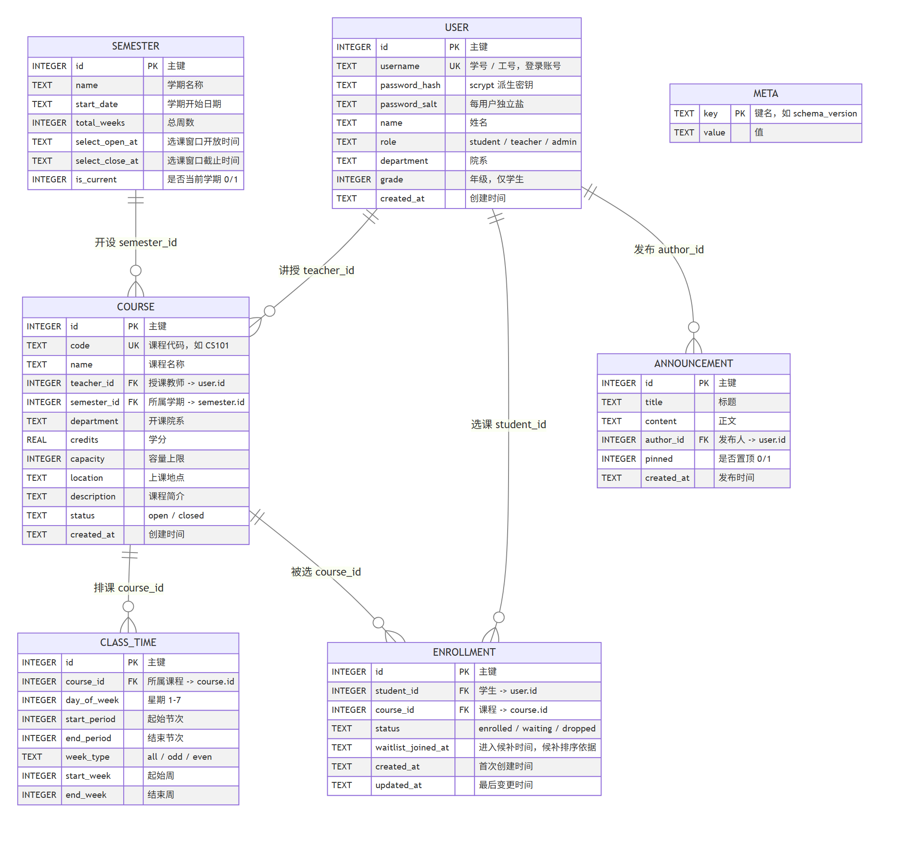
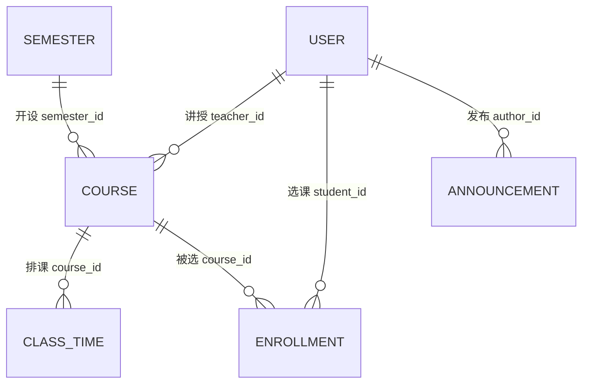

# 数据库设计文档

| 项目 | 内容 |
| --- | --- |
| 文档编号 | D4 |
| 项目名称 | 高校选课系统 |
| 版本 | v1.0（对应代码 v0.2.0） |
| 编写日期 | 2026-10-18 |
| 依据 | `docs/00-需求确认清单.md`（需求基线） |

> **2026-10-22 重要变更**：数据库由 **SQLite 单文件**改为 **PostgreSQL 18（Neon 托管，Singapore）**，
> 目的是让「本地部署」与「线上部署」共用同一个库、数据实时一致。
> SQLite 保留为**离线开发与回退方案**（`DB_DRIVER=sqlite`）。
> 决策与迁移过程见 [`dev/07-PostgreSQL迁移方案.md`](dev/07-PostgreSQL迁移方案.md) /
> [`dev/08-迁移执行记录.md`](dev/08-迁移执行记录.md)。
>
> 下文凡是标注「两库差异」的地方，均给出两种实现；未标注的部分两库一致。

---

## 一、文档说明

### 1.1 编写目的

说明选课系统数据库的设计结果，包括：选型理由、概念模型（ER 图）、逻辑结构（表结构）、
完整性约束、索引设计、关键设计决策的取舍，以及需求与数据结构的追溯关系。
供开发、测试、评审与后续维护使用。

### 1.2 与其他文档的关系

| 文档 | 关系 |
| --- | --- |
| `00-需求确认清单.md` | **上游依据**。本文的每个结构都能追溯到其中的需求条目 |
| `02-概要设计说明书.md` | 上游。本文落实其数据分层 |
| `03-详细设计说明书.md` | 并行。本文描述"数据长什么样"，详细设计描述"代码怎么用数据" |
| `docs/dev/02-数据库设计说明.md` | 开发者视角的精简版，侧重"改表怎么改"，与本文不冲突 |

### 1.3 术语约定

| 术语 | 含义 |
| --- | --- |
| 课程（course） | 本系统中指**某学期的一门开课班次**，含教师、容量、排课 |
| 节次 | 一天内的时间片，1~12 节，与具体钟点时间的映射见 `src/config.js` |
| 周次 | 学期内的第 N 周，1~16（可配置） |
| 候补 | 课程满员后的排队机制，按进入时间先进先出 |

---

## 二、设计概述

### 2.1 数据库管理系统选型

| 候选方案 | 优势 | 代价 / 风险 | 结论 |
| --- | --- | --- | --- |
| **PostgreSQL 18**（Neon 托管） | 真正的多写者并发（行锁 + MVCC）；本地与线上可共用一库；类型系统与约束完备 | 需要网络；跨境访问实测 300~500 ms/查询；免费额度有空闲休眠 | ✅ **现采用（生产 + 默认）** |
| SQLite 3 | 单文件、零安装零配置；无网络依赖；"双击就能跑" | **单文件无法跨机器共享**；文件锁在网络盘上不可靠（SQLite 官方明确警告） | ⚠️ **保留为离线开发 / 回退** |
| MySQL 8 | 成熟、生态完整、写入并发强 | 需自行运维服务；无对应免费托管方案 | ❌ 不选 |
| 内存数据库 | 极快 | 不持久，无法演示"重启后数据仍在" | ❌ 不满足 |

**为什么最初选 SQLite**：本系统是课程作业性质的单机演示应用，需求基线 E1 为"演示级数据规模"
（数十门课程、十余人）。SQLite 在零运维前提下提供完整事务与约束，评审方无需安装数据库服务。

**为什么改为 PostgreSQL**：需求后来演进出"本地改的数据，线上立刻能看到"。
SQLite 的**单文件**特性在这里成了硬障碍——两台机器无法共享同一个库文件，
把库放在网络盘/网盘上会因文件锁失效而损坏数据（这是 SQLite 官方明确警告的场景）。

**为什么仍然保留 SQLite**：它是离线开发与快速回归的最优解。
同样 118 项测试，SQLite 约 40 秒，PostgreSQL（跨境）需 200 秒以上。
双驱动由 `DATABASE_URL` 是否存在自动切换，出问题删掉环境变量即可回退。

**并发正确性的实现差异**（两库差异）：

| | SQLite | PostgreSQL |
| --- | --- | --- |
| 串行化手段 | `BEGIN IMMEDIATE` 事务开始即取写锁 | `SELECT ... FOR UPDATE OF c` 锁住课程行 |
| 隔离级别 | 等效 SERIALIZABLE | READ COMMITTED（默认）+ 行锁 |
| 实测结论 | 10 抢 3 → 选中 3 | 10 抢 3 → 选中 3（连跑 3 轮稳定） |

### 2.2 设计原则

1. **单一事实来源**：所有表的定义只写在 `src/db/schema.sql`，应用代码不建表。
2. **约束尽量下沉到数据库**：能用 `UNIQUE` / `CHECK` / `FOREIGN KEY` 表达的，不放到应用层。
3. **状态用枚举字符串而非魔法数字**：`'enrolled'` 比 `1` 可读，配合 `CHECK` 同样安全。
4. **不预留用不上的字段**：需求基线明确"不做"的功能（学分统计、先修课、日志审计等）不建表。
5. **可演进**：无法预判的扩展点记录在第十二节，而不是提前拆表。

### 2.3 命名与类型约定

| 对象 | 约定 | 示例 |
| --- | --- | --- |
| 表名 | 小写、下划线、单数 | `class_time`、`enrollment` |
| 字段名 | 小写、下划线 | `day_of_week`、`waitlist_joined_at` |
| 主键 | 一律命名 `id`；PG: `INTEGER GENERATED ALWAYS AS IDENTITY`；SQLite: `INTEGER PRIMARY KEY AUTOINCREMENT` | `id` |
| 外键 | `<被引用表单数>_id` | `teacher_id`、`course_id` |
| 索引 | `idx_<表>_<用途>` | `idx_enrollment_waitlist` |
| 布尔 | 两库统一用 `SMALLINT` + `CHECK (... IN (0,1))`（不引入布尔类型，避免 JS 与 SQL 来回转换） | `pinned`、`is_current` |
| 时间 | `TEXT`，格式 `YYYY-MM-DD HH:MM:SS` | `created_at` |
| 日期 | `TEXT`，格式 `YYYY-MM-DD` | `start_date` |
| 学分 | PG: `DOUBLE PRECISION`（**不用 NUMERIC**，node-postgres 会解析成字符串）；SQLite: `REAL` | `credits` |

**字符编码**：UTF-8。SQLite 由应用层统一以 UTF-8 读写；PostgreSQL 库级默认 UTF8。

**保留字注意**：`user` 是 PostgreSQL 保留字，建表与查询必须写成 `"user"`。
数据访问层会在 `FROM / JOIN / INTO / UPDATE` 之后自动补引号，业务 SQL 无需改动。

---

## 三、概念模型（ER 图）

**图 U7：数据库实体关系图**



> 源文件：`docs/diagrams/er-diagram.mmd`（Mermaid 格式，可重新导出）
> 重新生成方法见附录 B。

### 3.1 实体与关系说明

| 关系 | 基数 | 说明 |
| --- | --- | --- |
| `user`(教师) — `course` | 1 : N | 一位教师可讲授多门课；一门课只有一个主讲教师 |
| `user`(学生) — `enrollment` | 1 : N | 一位学生可有多条选课记录 |
| `user`(管理员) — `announcement` | 1 : N | 公告由管理员发布 |
| `semester` — `course` | 1 : N | 一个学期开设多门课；一门课只属于一个学期 |
| `course` — `class_time` | 1 : N | 一门课可有多段上课时间（如周一 1-2 节 + 周三 3-4 节） |
| `course` — `enrollment` | 1 : N | 一门课被多名学生选择 |
| `meta` | 独立 | 元信息表，无外键关系 |

> 说明：`user` 表被三种关系引用（教师、学生、发布人），
> 在 ER 图中表现为三条独立的连线，物理上都是指向 `user.id` 的外键。

### 3.2 Mermaid 源（与上图一致，便于在 Markdown 中直接渲染）



---

## 四、逻辑结构设计（表结构明细）

数据库共 **7 张表**。建表脚本：`src/db/schema.sql`。

| 序号 | 表名 | 中文名 | 预估行数（演示） | 说明 |
| --- | --- | --- | --- | --- |
| 1 | `meta` | 元信息 | 2 | 结构版本、初始化时间 |
| 2 | `user` | 用户 | 53 | 学生 / 教师 / 管理员 |
| 3 | `semester` | 学期 | 1 | 含选课窗口时间 |
| 4 | `course` | 课程 | 33 | 某学期的开课班次 |
| 5 | `class_time` | 上课时间 | 37 | 一门课可多段 |
| 6 | `enrollment` | 选课记录 | 114 | 已选 / 候补 / 已退 |
| 7 | `announcement` | 公告 | 3 | 管理员发布 |

---

### 4.1 `meta` — 元信息

用于记录与业务无关的库级信息，避免把版本号写死在代码里。

| 字段 | 类型 | 允许空 | 默认 | 约束 | 说明 |
| --- | --- | --- | --- | --- | --- |
| `key` | TEXT | 否 | — | PRIMARY KEY | 键名，如 `schema_version`、`seeded_at` |
| `value` | TEXT | 否 | — | NOT NULL | 值 |

---

### 4.2 `user` — 用户

学生、教师、管理员共存于一张表，用 `role` 区分。

| 字段 | 类型 | 允许空 | 默认 | 约束 | 说明 |
| --- | --- | --- | --- | --- | --- |
| `id` | INTEGER | 否 | 自增 | PRIMARY KEY | 主键 |
| `username` | TEXT | 否 | — | NOT NULL, **UNIQUE** | 学生为学号，教师/管理员为工号；登录账号 |
| `password_hash` | TEXT | 否 | — | NOT NULL | scrypt 派生密钥（十六进制，64 字节） |
| `password_salt` | TEXT | 否 | — | NOT NULL | 每用户独立的 16 字节随机盐（十六进制） |
| `name` | TEXT | 否 | — | NOT NULL | 姓名 |
| `role` | TEXT | 否 | — | NOT NULL, **CHECK** `IN ('student','teacher','admin')` | 角色 |
| `department` | TEXT | 是 | NULL | — | 院系 |
| `grade` | INTEGER | 是 | NULL | — | 年级，仅学生有值 |
| `created_at` | TEXT | 否 | — | NOT NULL | 创建时间 |

**索引**：`idx_user_role(role)` — 按角色统计学生/教师人数。

**设计说明**：口令不存明文，存 `salt + hash` 两列。三列合起来构成"可校验但不泄露"的最小集合。
不使用 `password` 单列拼接串，是为了让加盐与验证逻辑在应用层更直白。

---

### 4.3 `semester` — 学期

| 字段 | 类型 | 允许空 | 默认 | 约束 | 说明 |
| --- | --- | --- | --- | --- | --- |
| `id` | INTEGER | 否 | 自增 | PRIMARY KEY | 主键 |
| `name` | TEXT | 否 | — | NOT NULL | 如"2026-2027 学年第一学期" |
| `start_date` | TEXT | 否 | — | NOT NULL | 学期第一天，用于"第 N 周"与日期的换算 |
| `total_weeks` | INTEGER | 否 | 16 | NOT NULL | 总周数 |
| `select_open_at` | TEXT | 是 | NULL | — | 选课窗口开放时间（B2） |
| `select_close_at` | TEXT | 是 | NULL | — | 选课窗口截止时间（B2） |
| `is_current` | INTEGER | 否 | 0 | NOT NULL, **CHECK** `IN (0,1)` | 是否当前学期 |

**设计说明**：选课窗口的**两个时间点**直接放在学期表上，因为本系统一个学期只有一轮选课窗口
（需求 B2 的结论是"管理员可配置"一轮窗口，未要求多轮）。多轮次场景的演进方案见第十二节。

`is_current` 没有用 `UNIQUE` 保证"同时只有一个 1"——SQLite 的部分唯一索引可以做到
（`CREATE UNIQUE INDEX ... WHERE is_current = 1`），但应用层始终只查 `WHERE is_current = 1`，
即使出现脏数据也只影响结果显示。当前由 `seed.js` 保证唯一，记为已知约束。

---

### 4.4 `course` — 课程

| 字段 | 类型 | 允许空 | 默认 | 约束 | 说明 |
| --- | --- | --- | --- | --- | --- |
| `id` | INTEGER | 否 | 自增 | PRIMARY KEY | 主键 |
| `code` | TEXT | 否 | — | NOT NULL, **UNIQUE** | 课程代码，如 `CS101` |
| `name` | TEXT | 否 | — | NOT NULL | 课程名称 |
| `teacher_id` | INTEGER | 否 | — | NOT NULL, **FK** → `user.id` | 授课教师 |
| `semester_id` | INTEGER | 否 | — | NOT NULL, **FK** → `semester.id` | 所属学期 |
| `department` | TEXT | 是 | NULL | — | 开课院系 |
| `credits` | DOUBLE PRECISION（SQLite: REAL） | 否 | 2.0 | NOT NULL | 学分（支持 .5） |
| `capacity` | INTEGER | 否 | — | NOT NULL, **CHECK** `>= 0` | 容量上限（§2.1-4 人数限制的依据） |
| `location` | TEXT | 是 | NULL | — | 上课地点 |
| `description` | TEXT | 是 | NULL | — | 课程简介 |
| `status` | TEXT | 否 | `'open'` | NOT NULL, **CHECK** `IN ('open','closed')` | 开课 / 停开 |
| `created_at` | TEXT | 否 | — | NOT NULL | 创建时间 |

**索引**：
- `idx_course_semester(semester_id, status)` — 查某学期的开课列表（课程查询主路径）
- `idx_course_teacher(teacher_id)` — 教师查自己所授课程
- `idx_course_name(name)` — 课程名模糊检索

**设计说明**：`teacher_id` 未加 `CHECK` 限定"必须指向教师角色"。SQLite 无法在 `CHECK` 中
做跨表查询；该约束由应用层在 `adminService.validateCourse` 中校验（见 5.5）。

---

### 4.5 `class_time` — 上课时间

| 字段 | 类型 | 允许空 | 默认 | 约束 | 说明 |
| --- | --- | --- | --- | --- | --- |
| `id` | INTEGER | 否 | 自增 | PRIMARY KEY | 主键 |
| `course_id` | INTEGER | 否 | — | NOT NULL, **FK** → `course.id` **ON DELETE CASCADE** | 所属课程 |
| `day_of_week` | INTEGER | 否 | — | NOT NULL, **CHECK** `BETWEEN 1 AND 7` | 1=周一 … 7=周日（C1） |
| `start_period` | INTEGER | 否 | — | NOT NULL, **CHECK** `>= 1` | 起始节次 |
| `end_period` | INTEGER | 否 | — | NOT NULL, **CHECK** `>= 1` | 结束节次 |
| `week_type` | TEXT | 否 | `'all'` | NOT NULL, **CHECK** `IN ('all','odd','even')` | 每周 / 单周 / 双周（C2） |
| `start_week` | INTEGER | 否 | 1 | NOT NULL | 起始周 |
| `end_week` | INTEGER | 否 | 16 | NOT NULL | 结束周 |
| — | — | — | — | **表级 CHECK** `end_period >= start_period` | 节次区间合法 |
| — | — | — | — | **表级 CHECK** `end_week >= start_week` | 周次区间合法 |

**索引**：
- `idx_class_time_course(course_id)` — 取某课全部排课
- `idx_class_time_slot(day_of_week, start_period, end_period)` — 按时间维度筛选/比对

**设计说明**：
- 一门课有多段课，故独立成表，而不是在 `course` 上放 `time_1`/`time_2` 字段。
- `ON DELETE CASCADE` 只加在这里：删除课程时排课随之删除。而 `enrollment` **不**级联，
  避免误删课程连带抹掉学生的选课记录（详见第七节 7.3）。
- 节次是"第几节"而非钟点时间，钟点映射集中在 `src/config.js`，改作息时间不需要改数据。

---

### 4.6 `enrollment` — 选课记录

| 字段 | 类型 | 允许空 | 默认 | 约束 | 说明 |
| --- | --- | --- | --- | --- | --- |
| `id` | INTEGER | 否 | 自增 | PRIMARY KEY | 主键 |
| `student_id` | INTEGER | 否 | — | NOT NULL, **FK** → `user.id` | 学生 |
| `course_id` | INTEGER | 否 | — | NOT NULL, **FK** → `course.id` | 课程 |
| `status` | TEXT | 否 | — | NOT NULL, **CHECK** `IN ('enrolled','waiting','dropped')` | 已选 / 候补 / 已退 |
| `waitlist_joined_at` | TEXT | 是 | NULL | — | 进入候补的时间，候补 FIFO 的排序依据（R1） |
| `created_at` | TEXT | 否 | — | NOT NULL | 首次创建时间 |
| `updated_at` | TEXT | 否 | — | NOT NULL | 最后变更时间 |
| — | — | — | — | **UNIQUE** `(student_id, course_id)` | 一个学生对一门课只有一行 |

**索引**：
- `idx_enrollment_student(student_id, status)` — 查学生已选/候补课程
- `idx_enrollment_course(course_id, status)` — **统计已选人数（算余量的高频查询）**
- `idx_enrollment_waitlist(course_id, waitlist_joined_at) WHERE status='waiting'`
  — 部分索引，只覆盖候补行，用于快速取候补队首

**设计说明**：这是全库设计上最关键的一张表，三处非直觉设计见第七节 7.4、7.5。

---

### 4.7 `announcement` — 公告

| 字段 | 类型 | 允许空 | 默认 | 约束 | 说明 |
| --- | --- | --- | --- | --- | --- |
| `id` | INTEGER | 否 | 自增 | PRIMARY KEY | 主键 |
| `title` | TEXT | 否 | — | NOT NULL | 标题（应用层限 100 字） |
| `content` | TEXT | 否 | — | NOT NULL | 正文（应用层限 2000 字） |
| `author_id` | INTEGER | 否 | — | NOT NULL, **FK** → `user.id` | 发布人 |
| `pinned` | INTEGER | 否 | 0 | NOT NULL, **CHECK** `IN (0,1)` | 是否置顶 |
| `created_at` | TEXT | 否 | — | NOT NULL | 发布时间 |

**索引**：`idx_announcement_created(created_at DESC)` — 列表按时间倒序。

**设计说明**：长度限制放在应用层（`announcementService`）而非 `CHECK`，
因为 SQLite 的 `length()` 对中文按字符计，与应用层语义一致，但错误提示需要中文文案，
放数据库里只能抛英文错误。

---

## 五、完整性约束

### 5.1 主键约束（7 处）

7 张表中 6 张以 `id` 为自增主键（PG: `GENERATED ALWAYS AS IDENTITY`；SQLite: `AUTOINCREMENT`），`meta` 以 `key` 为主键——这一点会影响 `RETURNING id` 的处理，见 dev/07 第四节。

### 5.2 外键约束（7 处）

| 子表.字段 | 引用 | 删除策略 | 说明 |
| --- | --- | --- | --- |
| `course.teacher_id` | `user.id` | RESTRICT（默认） | 有课程的教师不可删 |
| `course.semester_id` | `semester.id` | RESTRICT | 有课程的学期不可删 |
| `class_time.course_id` | `course.id` | **CASCADE** | 删课程连带删排课 |
| `enrollment.student_id` | `user.id` | RESTRICT | 有选课记录的学生不可删 |
| `enrollment.course_id` | `course.id` | RESTRICT | **有选课记录的课程不可删**（业务上表现为提示改为停开） |
| `announcement.author_id` | `user.id` | RESTRICT | 有公告的用户不可删 |

外键在每次连接打开时通过 `PRAGMA foreign_keys = ON` 启用（SQLite 默认关闭，这点常被忽略）。

### 5.3 唯一约束（3 处）

| 约束 | 表 | 业务含义 |
| --- | --- | --- |
| `UNIQUE(username)` | user | 学号/工号不重复，登录账号唯一 |
| `UNIQUE(code)` | course | 课程代码唯一 |
| `UNIQUE(student_id, course_id)` | enrollment | 同一学生对同一门课只有一条记录，天然防重复选课 |

### 5.4 CHECK 约束清单（8 处）

| 表 | 约束 | 防的是什么 |
| --- | --- | --- |
| `user` | `role IN ('student','teacher','admin')` | 非法角色 |
| `semester` | `is_current IN (0,1)` | 布尔字段被写成 2/字符串 |
| `course` | `capacity >= 0` | 负容量（会导致"余量为负"的荒谬结果） |
| `course` | `status IN ('open','closed')` | 非法状态 |
| `class_time` | `day_of_week BETWEEN 1 AND 7` | 星期越界 |
| `class_time` | `start_period >= 1`、`end_period >= 1` | 节次为 0 或负 |
| `class_time` | `end_period >= start_period`、`end_week >= start_week` | **区间反向**（会让冲突判定失效） |
| `enrollment` | `status IN ('enrolled','waiting','dropped')` | 非法状态 |
| `announcement` | `pinned IN (0,1)` | 布尔字段被写脏 |

### 5.5 由应用层保证的约束（无法用 SQL 表达）

| 约束 | 保证位置 |
| --- | --- |
| `course.teacher_id` 必须指向 `role='teacher'` 的用户 | `adminService.validateCourse` |
| 课程的 `semester_id` 必须是当前学期 | `adminService.saveCourse` |
| 选课必须发生在选课窗口内（B2） | `enrollmentService.enroll` → `windowService` |
| 选课不得与已选课程时间冲突（C1~C3） | `enrollmentService.enroll` → `conflictService` |
| 已选人数不得超过 `capacity`（§2.1-4） | `enrollmentService.enroll`（事务内实时计数） |
| 候补人数不得超过 `capacity`（R2） | `enrollmentService.enroll` |
| 候补 FIFO 顺序（R1） | `ORDER BY waitlist_joined_at, id` |
| 同一时刻只有一个 `is_current = 1` | `seed.js`（单学期场景） |

---

## 六、索引设计

共 **10 个索引**（不含主键自动索引）。

| 索引 | 表 | 类型 | 支撑的查询 | 不加会怎样 |
| --- | --- | --- | --- | --- |
| `idx_user_role` | user | 普通 | 后台统计教师/学生人数 | 全表扫，演示规模无感，规模上来变慢 |
| `idx_course_semester` | course | 组合 | 课程查询主路径（按学期+状态） | 每次列表都全表扫 course |
| `idx_course_teacher` | course | 普通 | 教师端"我的课程" | 全表扫 |
| `idx_course_name` | course | 普通 | 课程名模糊检索 | `LIKE '%x%'` 本就用不上索引，保留是为将来等值/前缀查询 |
| `idx_class_time_course` | class_time | 普通 | 取某课全部排课 | 每次详情页都全表扫 |
| `idx_class_time_slot` | class_time | 组合 | 按"星期+节次"筛课、冲突比对 | 冲突判定需全表扫 |
| `idx_enrollment_student` | enrollment | 组合 | "我的选课" | 全表扫 |
| `idx_enrollment_course` | enrollment | 组合 | **统计已选/候补人数（算余量，每次选课必查）** | 选修课高峰期性能瓶颈 |
| `idx_enrollment_waitlist` | enrollment | **部分索引** | 取候补队首 | 需扫描大量非候补行 |
| `idx_announcement_created` | announcement | 普通 | 公告列表倒序 | 全表扫+排序 |

**说明**：
- 组合索引的列序按"等值在前、范围在后、排序字段最后"的原则排列。
- `idx_enrollment_waitlist` 是部分索引（`WHERE status='waiting'`），只索引候补行，
  体积远小于全量索引——候补查询是最热的路径之一，值这个优化。
- 本项目**未做**执行计划（`EXPLAIN QUERY PLAN`）前后的量化对比，记为已知欠账，见第十二节。

---

## 七、关键设计决策与取舍

> 以下每项都曾在设计阶段存在至少两个候选方案，记录取舍理由，
> 供后续维护者判断"这个设计是有意为之，还是历史遗留"。

### 7.1 三种角色：单表 vs 分表

| 方案 | 优势 | 劣势 |
| --- | --- | --- |
| **A. 单表 + role 字段**（采用） | 登录只需查一张表；公共字段（姓名、院系、口令）不重复 | 学生独有的 `grade` 对教师为空；角色相关字段多了会稀疏 |
| B. 三张表（student/teacher/admin） | 各角色字段互不干扰 | 登录要先判断角色再查对应表，或查三次；外键引用用户时需分表处理 |
| C. 单表 + 角色扩展表 | 兼顾两者 | 多一次 JOIN，演示项目收益不明显 |

**选择 A**。当前三角色字段重合度极高（都只有姓名、院系、口令），
`grade` 一个空字段的代价远小于分表带来的登录与外键复杂度。

**何时该改**：当某角色出现 3 个以上专属字段（如教师的职称、工号编制、所属系所）时，
再考虑 C 方案。

### 7.2 `course` = 开课班次，还是拆出 `course_offering`

| 方案 | 优势 | 劣势 |
| --- | --- | --- |
| **A. 一门课直接含教师与排课**（采用） | 表少、查询简单；符合"一学期一门课一个班"的现状 | 无法表达"同一门课多个班次" |
| B. `course`(课程目录) + `course_offering`(开课班次) | 贴近真实教务模型，支持同课多班、跨学期复用课程信息 | 表数量翻倍，所有查询都要多一层 JOIN |

**选择 A**。需求基线中"同课多班"属于范围外（`§2.2 明确不做`未列，但 §2.1 的功能项均按"一门课一个班"描述，
且演示数据无此场景）。**过度建模的代价是每个查询都变复杂**。

**何时该改**：需要同一门课由不同教师在不同时间开多个班时。迁移路径见 12.3。

### 7.3 `enrollment`：单行状态机 vs 删除行

| 方案 | 优势 | 劣势 |
| --- | --- | --- |
| **A. 单行 + status 状态机**（采用） | 保留历史；退课后重选只是更新这一行；`UNIQUE(student_id, course_id)` 天然防重 | 表里会积累 `dropped` 行，统计时要带上 `status` 条件 |
| B. 退课即删除行 | 表干净 | 丢失历史；重选要重新 INSERT，无法体现"重新排队"规则（R9） |

**选择 A**，直接支撑规则 R9：学生退课后重选，**更新同一行**的 `status` 与
`waitlist_joined_at`，天然排到候补队尾，不需要额外的历史表。

### 7.4 候补排序：`waitlist_joined_at` vs `created_at`

这是**最容易踩错的一处**。

| 方案 | 结果 |
| --- | --- |
| 用 `created_at` 排序 | ❌ 违反 R9：学生退课后重选，`created_at` 仍是最早时间，会"插队"到候补前列 |
| **用独立的 `waitlist_joined_at`**（采用） | ✅ 每次**进入候补**时刷新该字段，天然实现"重新排队" |

代价是多一个字段、且退出候补时要置空（`status='dropped'` 时置 NULL），
换来的是规则 R9 的正确性。**不要为了省一个字段而合并这两者。**

### 7.5 周次表达：三态+区间 vs 位图

| 方案 | 优势 | 劣势 |
| --- | --- | --- |
| **A. `week_type`(all/odd/even) + `start_week`/`end_week`**（采用） | 直观、可读、可手工录入；覆盖绝大多数教务场景 | 无法表达"第 3、5、9 周"这种不规则集合 |
| B. 16 位位图（如 `INTEGER` 存 0b…） | 表达力最强，判定用位运算极快 | 无法阅读与调试；管理后台要靠勾选框拼位，易错 |

**选择 A**。冲突判定时把"三态+区间"展开成周集合再求交，最多循环 16 次，成本可忽略。

### 7.6 时间存储：字符串 vs UNIX 时间戳

| 方案 | 优势 | 劣势 |
| --- | --- | --- |
| **A. `TEXT 'YYYY-MM-DD HH:MM:SS'`**（采用） | 直接可读；SQLite 里字符串比较即时间比较；导出 CSV 无需转换 | 占用空间略大于整数；跨时区需应用层约定 |
| B. `INTEGER` UNIX 秒 | 存储紧凑、比较快 | 调试时看不懂；每次都要格式化 |

**选择 A**。演示项目里"打开数据库就能看懂"的调试价值，远大于那点存储与性能差异。

⚠️ **注意**：JS 中 `new Date('2026-10-16 10:00:00')` 在部分环境下解析不可靠，
比较前需 `new Date(str.replace(' ', 'T'))`。该约定已写入 `windowService.parseTime()`。

### 7.7 并发正确性：靠什么保证"不超卖"

三层保障，缺一不可：

| 层次 | 手段 | 说明 |
| --- | --- | --- |
| 1 | 单进程同步执行 | 本项目为 Node 单线程 + `node-sqlite3-wasm` 同步 API，两个请求不会交错执行 |
| 2 | **数据库事务** | 校验与占用名额在同一个 `BEGIN IMMEDIATE` 事务内，事务开始即取写锁 |
| 3 | 实时计数 | 容量判定用事务内重新统计的 `COUNT(*)`，不用页面上显示的旧数字 |

第 2 层是将来多进程部署时仍然有效的保障；第 1 层是当前部署形态的额外优势。
实测结论见 D5 测试报告（10 人并发抢 3 个名额 → 选中 3 人，容量未被突破）。

---

## 八、数据字典（枚举值）

| 表.字段 | 取值 | 含义 |
| --- | --- | --- |
| `user.role` | `student` | 学生 |
| | `teacher` | 教师 |
| | `admin` | 管理员 |
| `course.status` | `open` | 正常开课，可选 |
| | `closed` | 停开，不可选（已有选课记录保留） |
| `class_time.week_type` | `all` | 每周 |
| | `odd` | 单周（第 1、3、5… 周） |
| | `even` | 双周（第 2、4、6… 周） |
| `enrollment.status` | `enrolled` | 已选中，占用一个名额 |
| | `waiting` | 候补中，不占名额 |
| | `dropped` | 已退课（含主动退出候补），保留行以支撑 R9 |
| `semester.is_current` | `0` / `1` | 非当前 / 当前学期 |
| `announcement.pinned` | `0` / `1` | 不置顶 / 置顶 |

---

## 九、容量估算

### 9.1 演示规模（当前数据）

| 表 | 行数 | 说明 |
| --- | --- | --- |
| `user` | 53 | 1 管理员 + 12 教师 + 40 学生 |
| `semester` | 1 | — |
| `course` | 33 | — |
| `class_time` | 37 | 平均每门 1.1 段 |
| `enrollment` | 114 | 112 条已选 + 2 条候补 |
| `announcement` | 3 | — |

**SQLite 模式**：实测数据库文件 126,976 字节（约 124 KB）— `data/course-selection.sqlite`。

**PostgreSQL 模式**（Neon Free，Singapore）：同样 7 张表 / 同规模数据，占用远小于免费额度 1 GB。
实测迁移后：
- `npm run init-db:pg`（全量重建）约 **154 秒**（跨境 RTT ≈ 500 ms × 约 240 条写入）
- 单页查询 3~6 次，页面响应 1~5 秒（本机跨境）；Render 与 Neon 同区域时应为毫秒级
- 库内数据与 SQLite 模式完全一致（53/33/37/114/3）

### 9.2 中型学院规模估算

假设：在校生 3,000 人，每学期开课 800 门，平均每人选 8 门，每门课平均 1.5 段排课。

| 表 | 行数 | 单行估长 | 小计 |
| --- | --- | --- | --- |
| `user` | 3,000 | ~150 B | 0.45 MB |
| `course` | 800 | ~250 B | 0.20 MB |
| `class_time` | 1,200 | ~60 B | 0.07 MB |
| `enrollment` | 24,000 | ~100 B | 2.4 MB |
| `announcement` | 100 | ~1 KB | 0.10 MB |
| 索引开销 | — | 约数据量的 30% | ~1.0 MB |
| **合计** | | | **≈ 4.2 MB / 学期** |

**结论**：即使 4 年 8 个学期累积，也在 35 MB 以内，SQLite 处理毫无压力。
**真正的瓶颈不是容量，而是并发写入**——单写者模型下，选课高峰的排队等待会先成为问题，
这也正是需求基线把规模定为"演示级"的原因。

---

## 十、需求追溯矩阵

| 需求编号 | 需求内容 | 主要支撑的表 / 字段 |
| --- | --- | --- |
| A4 | 学号 + 密码登录 | `user.username`、`user.password_hash`、`user.password_salt` |
| B1 | 先到先得 + 实时校验 | `enrollment.status`、`course.capacity`、事务内计数 |
| B2 | 选课时间窗口 | `semester.select_open_at`、`semester.select_close_at` |
| B3 | 退课不做时间限制 | `enrollment.status`（退课只改状态，不校验窗口） |
| B4 | 候补队列 | `enrollment.status='waiting'`、`enrollment.waitlist_joined_at` |
| C1 | 时间粒度：星期 + 节次 | `class_time.day_of_week`、`start_period`、`end_period` |
| C2 | 支持单双周 | `class_time.week_type`、`start_week`、`end_week` |
| C3 | 相邻时段不算冲突 | 无需额外字段，由判定算法保证（闭区间比较） |
| D5 | 公告通知 | `announcement` 全表 |
| E1 | 演示级数据规模 | 全部表，见第九节 |
| E2 | 并发控制 | 事务 + `enrollment` 唯一约束 + `idx_enrollment_course` |
| R1 | 候补 FIFO | `enrollment.waitlist_joined_at` + `idx_enrollment_waitlist` |
| R2 | 候补上限 = 容量 | `course.capacity`（应用层比对） |
| R3 | 退课补位 | `enrollment.status`、`enrollment.waitlist_joined_at` |
| R4 | 冲突判定式 | `class_time` 全部时间字段 |
| R5 | 单双周三态表示 | `class_time.week_type` |
| R6 | 容量校验顺序 | 无额外字段，由 `enrollmentService` 的流程保证 |
| R7 | 教师端权限 | `course.teacher_id`（把 `teacher_id` 写进查询条件） |
| R8 | 管理员权限 | `user.role='admin'`；课程/学期/公告的写操作 |
| R9 | 退课后重选排候补队尾 | `enrollment.waitlist_joined_at`（重选时刷新） |
| §2.1-1 | 课程查询 | `course`、`class_time`、`enrollment`（统计人数） |
| §2.1-2 | 选课 | `enrollment`、`course.capacity` |
| §2.1-3 | 退课 | `enrollment.status` |
| §2.1-4 | 人数限制 | `course.capacity` |
| §2.1-5 | 时间冲突检查 | `class_time` |
| §2.1-6 | 选课结果查询 | `enrollment`（按 `student_id` + `status`） |
| §2.1-9 | 选课时间窗口配置 | `semester.select_open_at` / `select_close_at` |

---

## 十一、初始化、备份与迁移

### 11.1 初始化

```bash
npm run init-db     # 建表 + 写入演示数据（幂等：已有数据则跳过）
npm run reset-db    # 清空重建（会删除全部数据）
```

### 11.2 备份与恢复

数据库是**单文件**，备份即复制：

```bash
# 备份前必须先停止服务（SQLite 单进程占用）
copy data\course-selection.sqlite data\backup-20261018.sqlite
```

恢复：把备份文件覆盖回 `data/course-selection.sqlite`。

### 11.3 结构变更流程

SQLite 对 `ALTER TABLE` 支持有限（可加列，不便删改列）。本项目采用**重建式迁移**：

1. 修改 `src/db/schema.sql`（唯一事实来源）
2. 演示阶段：`npm run reset-db`
3. 需保留数据时：导出 → 建新表 → 导入 → 改名，并在本文档"变更记录"中写明步骤
4. **同步更新**：`docs/dev/02-数据库设计说明.md` 与本文档的字段表

### 11.4 变更记录

| 日期 | 版本 | 变更内容 |
| --- | --- | --- |
| 2026-10-16 | v0.1.0 | 初始 7 张表 |
| 2026-10-18 | v0.2.0 | 结构无变更；演示数据新增 `CS113`（用于教师端冲突演示），课程数 32 → 33 |
| 2026-10-20 | v0.2.1+ | 结构无变更；**演示用户扩充**：教师 9 → 12、学生 12 → 40（共 53 用户），
选课记录 12 → 114 条（新增学生按三套互不冲突的组合批量预置），数据库文件 108 KB → 124 KB |
| 2026-10-22 | v0.3.0 | **数据库迁移到 PostgreSQL 18**（Neon Singapore），SQLite 保留为离线/回退。
逻辑结构（7 张表、10 个索引、约束）不变；物理层变化：
`AUTOINCREMENT` → `GENERATED ALWAYS AS IDENTITY`、`REAL` → `DOUBLE PRECISION`、
删 `PRAGMA`、`INSERT OR REPLACE` → `ON CONFLICT DO UPDATE`、`user` 表名需加引号。
并发控制由 `BEGIN IMMEDIATE` 改为 `SELECT ... FOR UPDATE OF c`（详见 dev/07、dev/08） |

---

## 十二、已知限制与后续演进

### 12.1 已知限制

| 编号 | 限制 | 影响 | 缓解措施 |
| --- | --- | --- | --- |
| L1 | ~~单写者模型~~ → 已迁移 PostgreSQL | — | 已由 `SELECT ... FOR UPDATE` 行锁解决；SQLite 模式仍为单写者（仅用于离线开发） |
| L2 | 未对执行计划做量化对比 | 索引收益是"按预期"而非"已测量" | 数据量小，影响可忽略；列为后续待办 |
| L3 | `is_current` 无数据库级唯一保证 | 极端情况可能多个学期同时为 1 | 应用层只取 `ORDER BY id DESC LIMIT 1` 兜底 |
| L4 | 时间字段为字符串，无时区概念 | 跨时区部署需另行约定 | 单机演示场景不涉及 |
| L5 | 无操作审计表 | 无法追溯"谁在何时改了什么" | 需求 D3 明确不做 |
| L6 | 密码为演示级口令（`123456`） | 仅可用于教学演示 | 正式使用须强制改密并加复杂度校验 |
| L7 | 云端数据库为免费额度，空闲会休眠 | 冷启动首次查询多等约 1 秒 | 演示前预热一次；付费可关闭休眠 |
| L8 | 跨境访问延迟 300~500 ms | 本地开发页面偏慢 | 本地日常用 `DB_DRIVER=sqlite`，验证/演示切 PG |
| L9 | 连接串含密码 | 泄露即失守 | 只存 `.env`（已 gitignore）与平台环境变量；泄露时在控制台重置密码 |

### 12.2 演进原则

- 结构变更必须改 `schema.sql`，不允许在应用代码里 `CREATE TABLE`
- 每次变更同步本文档与 `docs/dev/02`
- 新增表前先问："能否用现有表 + 一个字段解决？"

### 12.3 演进预案

| 若需要… | 建议做法 | 影响范围 |
| --- | --- | --- |
| 同课多班次 | 新建 `course_offering(id, course_id, teacher_id, semester_id, capacity)`，`class_time` 与 `enrollment` 改指向它 | 大：所有查询与服务需调整 |
| 多轮次选课 | 新建 `selection_round(id, semester_id, name, open_at, close_at)`，窗口判定改读该表 | 中：`windowService` 与后台配置页 |
| 学分统计与培养方案 | 新建 `curriculum`、`curriculum_course` | 中：纯增量 |
| 先修课校验 | 新建 `prerequisite(course_id, required_course_id)` | 中：`enroll` 增加一步校验 |
| 操作审计 | 新建 `operation_log(actor_id, action, target, detail, created_at)` | 小：纯增量 |
| 志愿抽签 | 新建 `preference(student_id, course_id, priority, round_id)` | 大：选课机制重写 |

---

## 附录 A：完整建表脚本

见 `src/db/schema.sql`（含全部注释与索引定义）。

## 附录 B：ER 图重新生成

源文件 `docs/diagrams/er-diagram.mmd` 为 Mermaid 格式，三种渲染方式：

1. **GitHub / VS Code**：Markdown 中直接渲染（本文第 3.2 节已内嵌）
2. **导出 PNG（推荐 mermaid-cli）**：
   ```bash
   npx @mermaid-js/mermaid-cli -i docs/diagrams/er-diagram.mmd \
       -o docs/diagrams/er-diagram.png -w 2400 -b white
   ```
3. **无 Node 工具链时**：用浏览器打开任一在线 Mermaid 编辑器粘贴源码导出

> 本次提交的 `er-diagram.png` / `.svg` 是在本机无 Java、无 mermaid-cli 的条件下，
> 用 Chrome 无头模式加载 mermaid.js 渲染后截图得到的；
> 导出步骤与常见问题已记录在 `docs/dev/04-运行与维护手册.md`。

---

*文档结束*
