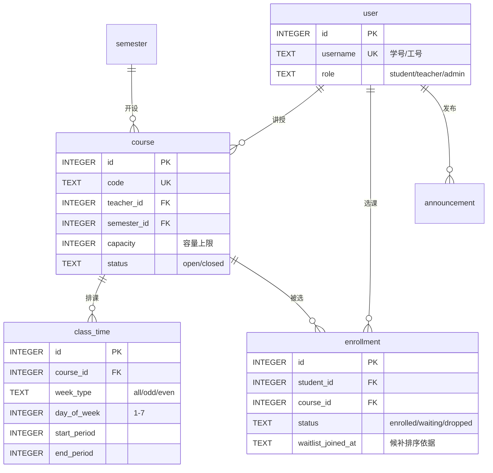

# 02 · 数据库设计说明

> 回答：有哪些表？每个字段什么含义？为什么这么设计？想改表该怎么做？
>
> 结构定义文件：`src/db/schema.sql`（**唯一事实来源**，改表请只改这里）

---

## 一、实体关系



---

## 二、表清单

| 表 | 中文名 | 说明 |
| --- | --- | --- |
| `meta` | 元信息 | 结构版本、初始化时间 |
| `user` | 用户 | 学生 / 教师 / 管理员统一存这张表，用 `role` 区分 |
| `semester` | 学期 | 含选课窗口的开放与截止时间 |
| `course` | 课程 | 某学期的开课班次，含容量上限 |
| `class_time` | 上课时间 | 一门课可有多段；单双周与周次区间在此表达 |
| `enrollment` | 选课记录 | 已选 / 候补 / 已退，三种状态共用一行 |
| `announcement` | 公告 | 管理员发布，全员可见 |

---

## 三、字段说明

### 3.1 `meta` — 元信息

| 字段 | 类型 | 说明 |
| --- | --- | --- |
| `key` | TEXT PK | 键名，如 `schema_version` |
| `value` | TEXT | 值 |

### 3.2 `user` — 用户

| 字段 | 类型 | 约束 | 说明 |
| --- | --- | --- | --- |
| `id` | INTEGER | PK 自增 | 主键 |
| `username` | TEXT | UNIQUE NOT NULL | 学生为学号，教师/管理员为工号，登录用 |
| `password_hash` | TEXT | NOT NULL | scrypt 派生密钥（十六进制） |
| `password_salt` | TEXT | NOT NULL | 每个用户独立随机盐 |
| `name` | TEXT | NOT NULL | 姓名 |
| `role` | TEXT | CHECK | `student` / `teacher` / `admin` |
| `department` | TEXT | 可空 | 院系 |
| `grade` | INTEGER | 可空 | 年级（仅学生有值） |
| `created_at` | TEXT | NOT NULL | 创建时间（`YYYY-MM-DD HH:MM:SS`） |

> **为什么三种角色共用一张表**：字段重合度高（都有姓名、院系、登录口令），
> 拆表会导致登录逻辑要查三张表。用 `role` 区分 + CHECK 约束即可，代价是学生独有的
> `grade` 字段对教师为空——这个代价可接受。

### 3.3 `semester` — 学期

| 字段 | 类型 | 约束 | 说明 |
| --- | --- | --- | --- |
| `id` | INTEGER | PK | 主键 |
| `name` | TEXT | NOT NULL | 如"2026-2027 学年第一学期" |
| `start_date` | TEXT | NOT NULL | 学期第一天，用于把"第 N 周"换算成日期 |
| `total_weeks` | INTEGER | NOT NULL | 总周数（默认 16） |
| `select_open_at` | TEXT | 可空 | 选课窗口开放时间 |
| `select_close_at` | TEXT | 可空 | 选课窗口截止时间 |
| `is_current` | INTEGER | CHECK 0/1 | 是否为当前学期（同时只应有一个为 1） |

> **选课窗口为什么放在学期表上**：本系统一个学期只有一轮选课窗口。若将来要支持
> "初选 / 补退选" 多轮，应新建 `selection_round` 表，见文末扩展点。

### 3.4 `course` — 课程

| 字段 | 类型 | 约束 | 说明 |
| --- | --- | --- | --- |
| `id` | INTEGER | PK | 主键 |
| `code` | TEXT | UNIQUE NOT NULL | 课程代码，如 `CS101` |
| `name` | TEXT | NOT NULL | 课程名 |
| `teacher_id` | INTEGER | FK → user.id | 授课教师 |
| `semester_id` | INTEGER | FK → semester.id | 所属学期 |
| `department` | TEXT | 可空 | 开课院系 |
| `credits` | REAL | NOT NULL | 学分 |
| `capacity` | INTEGER | CHECK ≥ 0 | **容量上限**（§2.1-4 人数限制的依据） |
| `location` | TEXT | 可空 | 上课地点 |
| `description` | TEXT | 可空 | 课程简介 |
| `status` | TEXT | CHECK | `open` 正常开课 / `closed` 停开 |
| `created_at` | TEXT | NOT NULL | 创建时间 |

### 3.5 `class_time` — 上课时间

| 字段 | 类型 | 约束 | 说明 |
| --- | --- | --- | --- |
| `id` | INTEGER | PK | 主键 |
| `course_id` | INTEGER | FK → course.id，ON DELETE CASCADE | 所属课程 |
| `day_of_week` | INTEGER | CHECK 1~7 | 星期（1 = 周一） |
| `start_period` | INTEGER | CHECK ≥ 1 | 起始节次 |
| `end_period` | INTEGER | CHECK ≥ start_period | 结束节次 |
| `week_type` | TEXT | CHECK | `all` 每周 / `odd` 单周 / `even` 双周 |
| `start_week` | INTEGER | 默认 1 | 起始周 |
| `end_week` | INTEGER | CHECK ≥ start_week | 结束周 |

> **周次为什么用"三态 + 区间"而不是位图**：三态（每周/单双周）覆盖了绝大多数教务场景，
> 且直观、可读、可手工录入；位图（16 位）表达力更强但难以阅读与调试。作业场景取前者。

### 3.6 `enrollment` — 选课记录

| 字段 | 类型 | 约束 | 说明 |
| --- | --- | --- | --- |
| `id` | INTEGER | PK | 主键 |
| `student_id` | INTEGER | FK → user.id | 学生 |
| `course_id` | INTEGER | FK → course.id | 课程 |
| `status` | TEXT | CHECK | `enrolled` 已选中 / `waiting` 候补中 / `dropped` 已退 |
| `waitlist_joined_at` | TEXT | 可空 | **进入候补的时间，候补排序依据（R1）** |
| `created_at` | TEXT | NOT NULL | 首次创建时间 |
| `updated_at` | TEXT | NOT NULL | 最后变更时间 |
| — | — | UNIQUE(student_id, course_id) | 一个学生对一门课只有一行 |

#### 为什么"已选 / 候补 / 已退"共用一行，而不是删行

1. **退课后重选要排候补队尾**（规则 R9）。留着 `dropped` 行，重选时更新这一行的
   `status` 和 `waitlist_joined_at` 即可，不需要额外的历史表。
2. 保留记录便于将来做操作审计（虽然当前需求 D3 不做）。
3. `UNIQUE(student_id, course_id)` 天然防止同一学生对同一门课产生多行脏数据。

#### 为什么候补排序用独立的 `waitlist_joined_at`

用 `created_at` 排序会导致规则 R9 失效：学生退课后重选，`created_at` 还是最早的时间，
他就"插队"到候补前面了。用独立的 `waitlist_joined_at`，每次**进入候补**时刷新，
天然实现"重新排队"。

### 3.7 `announcement` — 公告

| 字段 | 类型 | 约束 | 说明 |
| --- | --- | --- | --- |
| `id` | INTEGER | PK | 主键 |
| `title` | TEXT | NOT NULL | 标题 |
| `content` | TEXT | NOT NULL | 正文 |
| `author_id` | INTEGER | FK → user.id | 发布人 |
| `pinned` | INTEGER | CHECK 0/1 | 是否置顶 |
| `created_at` | TEXT | NOT NULL | 发布时间 |

---

## 四、索引说明

| 索引 | 表 | 目的 |
| --- | --- | --- |
| `idx_user_role` | user | 按角色统计学生/教师数 |
| `idx_course_semester` | course | 查某学期开课列表 |
| `idx_course_teacher` | course | 教师查自己所授课程 |
| `idx_course_name` | course | 课程名检索 |
| `idx_class_time_course` | class_time | 取某课程的全部上课时间 |
| `idx_class_time_slot` | class_time | 按"星期 + 节次"快速筛出可能冲突的课 |
| `idx_enrollment_student` | enrollment | 查学生已选课程 |
| `idx_enrollment_course` | enrollment | **统计某课程已选人数（算余量时高频使用）** |
| `idx_enrollment_waitlist` | enrollment | 部分索引，只覆盖 `status='waiting'`，用于取候补队首 |
| `idx_announcement_created` | announcement | 公告按发布时间倒序（首页与公告列表） |

---

## 五、时间格式约定

所有时间字段统一存 **`YYYY-MM-DD HH:MM:SS`** 格式的字符串（本地时间，非 UTC）。

- 好处：SQLite 里可以直接用字符串比较大小，排序即时间序，无需转换。
- 生成方式见 `src/db/seed.js` 的 `nowIso()`。
- ⚠️ 注意：JS 的 `new Date('2026-10-16 10:00:00')` 在部分环境下解析不可靠，
  比较时间时请用 `new Date(str.replace(' ', 'T'))`。

---

## 六、如何改表（迁移流程）

SQLite 不支持复杂的 `ALTER TABLE`，本项目采用**重建式迁移**：

1. 修改 `src/db/schema.sql`
2. 若是演示阶段（数据可丢）：
   ```bash
   npm run reset-db
   ```
3. 若需保留数据：自行导出 → 建新表 → 导入 → 改名的顺序处理，
   并在本文档"变更记录"中注明迁移步骤。

### 变更记录

| 日期 | 变更 | 说明 |
| --- | --- | --- |
| 2026-10-16 | 初始 7 张表 | v0.1.0 骨架 |

---

## 七、已知扩展点

| 若将来需要… | 建议做法 | 影响范围 |
| --- | --- | --- |
| 一门课多个班次（不同教师/时间） | 新建 `course_offering` 表，`class_time`、`enrollment` 改指向它 | 较大，需改服务层全部查询 |
| 多轮次选课（初选/补退选） | 新建 `selection_round` 表（含窗口时间），窗口校验改读它 | 中等，改 `windowService` |
| 选课操作审计 | 新增 `operation_log` 表，在服务层写日志 | 小，纯增 |
| 学分统计与培养方案 | 新增 `curriculum` / `curriculum_course` 表 | 中等，需求 D1 当前不做 |
| 先修课校验 | 新增 `prerequisite(course_id, required_course_id)` 表 | 中等，需求 D2 当前不做 |

---

*相关文档：[01-架构与代码地图](01-架构与代码地图.md) · [03-接口与页面规范](03-接口与页面规范.md)*
