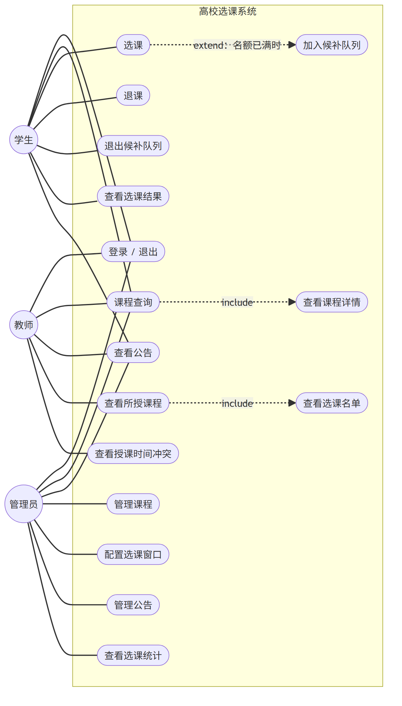
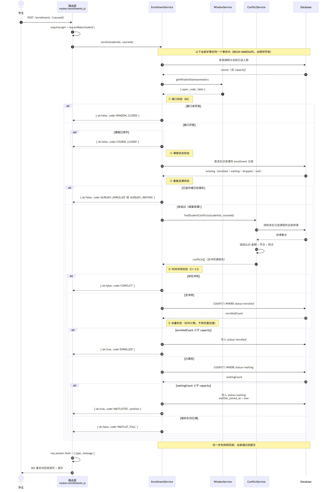

# 提交材料

> **本目录由 `npm run pack:submission` 自动生成，请勿直接编辑。**
> 修改内容请改 `docs/` 下的源文件，然后重新执行该命令。

| 项目 | 内容 |
| --- | --- |
| 项目名称 | 高校选课系统 |
| 代码版本 | v0.3.0 |
| 生成日期 | 2026-10-22 |
| 仓库地址 | <https://github.com/FHAZ-141/course-selection-system> |

---

## 一、文档清单

| 文件 | 内容 | 大小 |
| --- | --- | --- |
| `00-需求确认清单.md` | 需求基线：24 项决策 + 9 条推导规则 + 11 项功能范围 | 7 KB |
| `01-需求规格说明书.md` | 12 条功能需求（FR-00~FR-11），每条含可测的验收标准 | 33 KB |
| `02-概要设计说明书.md` | 分层架构、模块划分、关键设计决策、部署结构 | 20 KB |
| `03-详细设计说明书.md` | 类设计、4 个关键算法、6 张动态行为图、界面设计与错误码 | 27 KB |
| `04-数据库设计文档.md` | ER 图、7 张表逐字段说明、约束与索引、容量估算 | 36 KB |
| `05-测试用例与测试报告.md` | 118 条用例与实测结果、9 个缺陷记录、覆盖率分析与未覆盖项 | 24 KB |
| `06-项目总结报告.md` | 开发过程回顾、技术难点、问题与教训、不足与改进方向 | 23 KB |

**建议阅读顺序**：需求确认清单 → 需求规格说明书 → 概要设计说明书 → 详细设计说明书 → 数据库设计文档。
第一份是"为什么这么定"，后面依次是"要做成什么"、"整体怎么搭"、"每个类怎么实现"、"数据怎么存"。

## 二、图表清单

| 编号 | 图表 | 文件 | 所在文档 |
| --- | --- | --- | --- |
| U1 | 用例图 | `diagrams/use-case.png` | D1 第三节 |
| U2 | 类图 | `diagrams/class-diagram.png` | D2 第 4.2 节 |
| — | 分层架构图 | `diagrams/architecture-layers.png` | D2 第 3.1 节 |
| U3 | 选课时序图 | `diagrams/sequence-select-course.png` | D3 第 4.1 节 |
| U4 | 退课时序图 | `diagrams/sequence-drop-course.png` | D3 第 4.2 节 |
| U5 | 冲突校验活动图 | `diagrams/activity-conflict-check.png` | D3 第 4.3 节 |
| — | 候补补位活动图 | `diagrams/activity-promote-waitlist.png` | D3 第 4.4 节 |
| U6 | 选课记录状态图 | `diagrams/state-course-selection.png` | D3 第 4.5 节 |
| — | 界面导航图 | `diagrams/ui-sitemap.png` | D3 第 5.1 节 |
| U7 | 数据库 ER 图 | `diagrams/er-diagram.png` | D4 第三节 |

每张图均提供三种文件：

- `.png`：2 倍分辨率位图，可直接插入 Word / PPT
- `.svg`：矢量图，放大不失真，Word 2016+ 支持直接插入
- `.mmd`：Mermaid 源文件，可修改后重新导出（导出方法见仓库 `docs/diagrams/README.md`）

## 三、交付物完成情况

| 编号 | 名称 | 状态 |
| --- | --- | --- |
| — | 全部 14 项交付物均已产出 | ✅ |

> 完整清单含 6 份文档（D0~D6 中除 D0 外的正文）与 7 张 UML 图（U1~U7），
> 另有 3 张辅助图（分层架构、补位活动、界面导航）。

## 四、运行方式

拿到本目录所在的项目压缩包后：

1. 安装 Node.js 20 或以上（<https://nodejs.org>）
2. 双击项目根目录的 `start.bat`
3. 浏览器会自动打开 <http://localhost:3000>

演示账号（密码均为 `123456`）：`admin` 管理员、`T1001` 教师、`2024010101` 学生

详细步骤见项目根目录的 `README.md` 与 `PROGRESS.md`。
